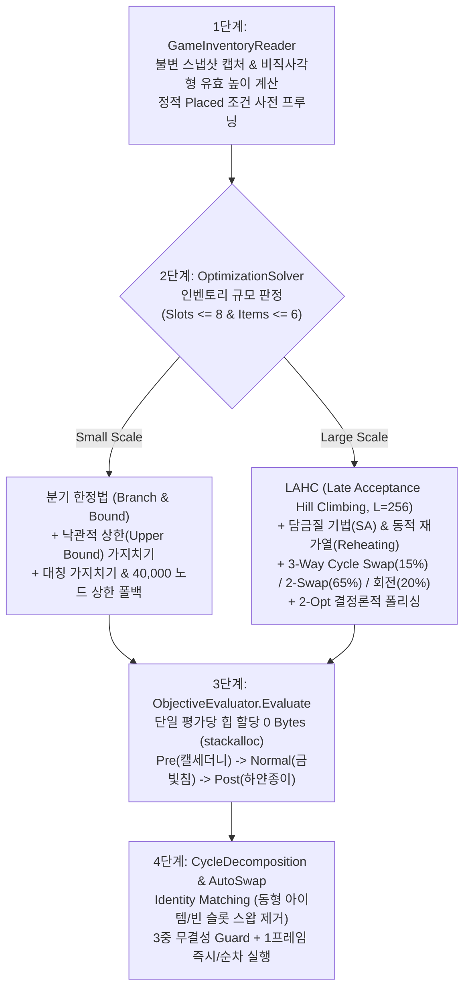

# SephiriaOptimizer (세피리아 인벤토리·석판·콤보 자동 최적화 모드)


-success)


스팀 게임 **세피리아(Sephiria)** 인벤토리의 아티팩트(`Charm_Basic`), 석판(`StoneTablet`), 동적 세트 콤보(`#태그`), 그리고 재능(`Passive`/`StatusInstance`) 규칙을 실시간 분석하여 **1) 단축키 한 번으로 최적 슬롯 자동 재배치(`[F5]`)**, **2) 슬롯 위 시각적 오버레이 가이드(`[F6]`)**, **3) 빌드 맞춤 아티팩트 우선순위·목표 콤보·금빛침 타겟 설정(`[F7]`)**을 제공하는 하이브리드 인게임 모드입니다.

> **별도의 모드 로더(`BepInEx` 등) 설치가 전혀 필요 없습니다!**
> 세피리아 게임 엔진에 내장된 공식 `AddOnLoader`(`HorayModBase`) 시스템을 그대로 사용하므로, 통합 자동 설치기 하나만 실행하면 즉시 적용됩니다.

---

## 목차 (Table of Contents)
1. [🚀 통합 원클릭 설치·업데이트·제거 가이드 (단일 표준 방식)](#-통합-원클릭-설치업데이트제거-가이드-단일-표준-방식)
   - [1.1 설치 및 업데이트 절차](#11-설치-및-업데이트-절차)
   - [1.2 모드 제거 절차](#12-모드-제거-절차)
   - [1.3 자동 처리되는 환경 대응 명세](#13-자동-처리되는-환경-대응-명세)
2. [🎮 인게임 단축키 및 UI 완벽 가이드](#-인게임-단축키-및-ui-완벽-가이드)
3. [🧠 세피리아 도메인 최적화 규칙 상세 명세](#-세피리아-도메인-최적화-규칙-상세-명세)
   - [3.1 유효 레벨 클램핑, 배율 정합성 및 비활성화·버프 낭비 방어](#31-유효-레벨-클램핑-배율-정합성-및-비활성화버프-낭비-방어)
   - [3.2 10종 아티팩트 위치·이웃 제약 조건 & 비직사각형 그리드 정합성](#32-10종-아티팩트-위치이웃-제약-조건--비직사각형-그리드-정합성)
   - [3.3 캘세더니 열쇠 & 하얀 종이 동적 #태그 콤보 파이프라인 (Pre → Normal → Post)](#33-캘세더니-열쇠--하얀-종이-동적-태그-콤보-파이프라인-pre--normal--post)
   - [3.4 북향의 금빛침 (Charm_UpCharmDamage) 타겟 지정·연쇄·순환 참조 차단](#34-북향의-금빛침-charm_upcharmdamage-타겟-지정연쇄순환-참조-차단)
   - [3.5 아티팩트 5단계 강화 우선순위 (ArtifactPriorityTier)](#35-아티팩트-5단계-강화-우선순위-artifactprioritytier)
   - [3.6 재능(Talent) 및 특수 빌드 규칙 자동 대응 (생존 20 석판 각인 등)](#36-재능talent-및-특수-빌드-규칙-자동-대응-생존-20-석판-각인-등)
   - [3.7 위치·이웃 의존 특수 아티팩트 시너지](#37-위치이웃-의존-특수-아티팩트-시너지)
4. [⚡ 4단계 파이프라인 알고리즘 및 아키텍처 설계](#-4단계-파이프라인-알고리즘-및-아키텍처-설계)
5. [❓ 자주 묻는 질문 & 환경별 트러블슈팅 (Troubleshooting)](#-자주-묻는-질문--환경별-트러블슈팅-troubleshooting)
6. [🛠️ 개발자용 프로젝트 구조 및 빌드·배포·테스트 가이드](#️-개발자용-프로젝트-구조-및-빌드배포테스트-가이드)

---

## 🚀 통합 원클릭 설치·업데이트·제거 가이드 (단일 표준 방식)

사용자가 여러 설치 방식 사이에서 고민하거나 스팀 폴더(`steamapps/common/Sephiria`)를 직접 찾아다니고 보안 차단을 수동으로 해제할 필요가 없도록, **로컬 릴리즈 패키지 기반 통합 자동 설치기** 단일 표준 방식으로 모든 적용 절차를 통합했습니다.

### 1.1 설치 및 업데이트 절차

1. **[👉 SephiriaOptimizer_v2.0.0.zip 다운로드](https://raw.githubusercontent.com/lij0825/SephiriaOptimizer/main/Dist/SephiriaOptimizer_v2.0.0.zip)** 후, 다운로드한 `.zip` 파일을 **반드시 압축 해제**합니다 (`우클릭 → 모두 압축 풀기`).
2. 압축을 푼 폴더에서 운영체제에 맞는 설치 런처를 실행합니다(새 버전 업데이트 시에도 동일하게 실행하면 기존 파일을 안전하게 원자적 교체합니다):
   - **Windows 10 / 11**: **`Install.bat`** 더블클릭
   - **Linux / SteamOS (Steam Deck) / macOS**: 터미널에서 아래 명령 실행
     ```bash
     chmod +x ./install.sh && ./install.sh
     ```
3. `"세피리아 최적화 모드(SephiriaOptimizer v2.0.0) 설치가 완료되었습니다!"` 알림이 표시되면 완료입니다. 게임을 실행하고 인벤토리(`I` 또는 `Tab`)를 열면 상단 컨트롤 바가 즉시 활성화됩니다.

### 1.2 모드 제거 절차

- **Windows 10 / 11**: 압축을 푼 폴더의 **`Uninstall.bat`** 더블클릭
- **Linux / SteamOS / macOS**:
  ```bash
  ./install.sh --uninstall
  ```
- 세피리아 내 `AddOns/SephiriaOptimizer` 폴더가 즉시 제거되며, 다른 애드온이 없어 `AddOns` 폴더가 비게 되면 빈 상위 폴더까지 깔끔하게 정리됩니다.

### 1.3 자동 처리되는 환경 대응 명세

통합 설치 엔진(`Dist/install.ps1` + `Install.bat` / `Uninstall.bat` / `install.sh`)과 빌드 파이프라인(`SephiriaOptimizer.csproj`)은 사용자별 환경 차이와 예외 상황을 아래 순서로 자동 방어합니다:

| 구분 | 자동 처리 및 방어 내역 |
| :--- | :--- |
| **다중 드라이브 & 스팀 라이브러리 탐색** | `SEPHIRIA_GAME_DIR` 환경 변수 → 이전 실행 시 기억된 캐시(`game_path.txt`) → Windows 레지스트리(`HKCU`/`HKLM`/`WOW6432Node` Steam & `Uninstall`) → 모든 마운트된 드라이브(`C:`~`Z:`, Steam Deck 외장 SD `/run/media/mmcblk0p1`, `/mnt`, `/media`, Linux Flatpak/Snap, macOS `Application Support/Steam`) → `libraryfolders.vdf`(v1/v2 포맷) 및 `appmanifest_*.acf` 커스텀 `installdir`을 순차 스캔하여 설치 드라이브에 관계없이 자동 탐지합니다. |
| **하위·상위 폴더 오지정 스마트 보정** | 수동 선택이나 CLI 인자(`--game-dir`)로 `Sephiria.exe`, `Sephiria.app`, `Sephiria_Data`, `Managed`, `AddOns`, `steamapps`, `common` 등 하위/상위 경로를 잘못 지정해도 실제 게임 루트를 역추적하여 OS별 정확한 `AddOns` 위치(Windows/Linux: `<GameRoot>/AddOns/SephiriaOptimizer`, macOS: `Sephiria.app/AddOns/SephiriaOptimizer`)에 설치합니다. |
| **한글·공백·특수문자 및 인코딩 무결성** | Windows 계정명이나 다운로드 폴더(`SephiriaOptimizer_v2.0.0 (1)`, `한글 [스팀] & 게임!` 등)에 한글(유니코드), 공백, 괄호 `( )`, 대괄호 `[ ]`, `&`, `!`가 포함되어도 `DisableDelayedExpansion` + `goto` 배치 런처, `-LiteralPath`/`.NET IO` 직접 호출, UTF-8 VDF 리더 및 런타임 유니코드 디코딩을 통해 PowerShell 5.1(`CP949`)과 PowerShell 7+(`UTF-8`) 모두에서 글자 깨짐·와일드카드 오작동 없이 동작합니다. |
| **보안 격리 해제 & 원자적 복사** | Windows 외부 DLL 보안 차단(`Mark of the Web` / `:Zone.Identifier` ADS) 및 macOS Gatekeeper 격리 속성(`com.apple.quarantine`)을 자동 제거하고, 읽기 전용(`ReadOnly`) 속성 해제 및 `.tmp` 임시 파일 스테이징·바이트 크기 검증 후 교체하여 손상된 DLL 생성을 원천 방지합니다. |
| **권한 승격(UAC) & 실행 중 잠금 방어** | `C:\Program Files (x86)` 등 보호된 경로에 쓰기 권한이 없으면 Windows 관리자 권한(UAC) 승격을 자동 요청하며, `Sephiria` 실행 중이거나 `SephiriaOptimizer.dll` 파일 핸들이 잠겨 있으면 덮어쓰기를 차단하고 게임 종료 후 `[재시도 / 취소]`할 수 있도록 안내합니다. |
| **내장 `AddOnLoader` 사전 검증 & 1회 경로 기억** | `Assembly-CSharp.dll` 내 공식 `AddOnLoader`(`HorayModBase`) 심볼 존재 여부를 검사해 구버전 게임 클라이언트를 사전 감지합니다. 비표준 포터블 설치 환경에서 1회 선택한 폴더는 OS 사용자 설정(`%LOCALAPPDATA%\SephiriaOptimizer\game_path.txt` 또는 `~/.config/SephiriaOptimizer/game_path.txt`)에 저장되어 이후 업데이트·제거·빌드 시 재입력이 필요 없으며, 게임을 다른 드라이브로 옮긴 경우 유효하지 않은 캐시를 자동 폐기하고 재탐색합니다. |

---

## 🎮 인게임 단축키 및 UI 완벽 가이드

게임을 실행하고 세이브 파일을 불러온 뒤 **인벤토리 창(`I` 또는 `Tab`)**을 열면 인벤토리 상단에 **Sephiria Optimizer** 컨트롤 패널과 슬롯 오버레이가 자동으로 표시됩니다. (인벤토리 창을 닫으면 모든 UI가 자동으로 숨겨집니다.)

### 1. 단축키 및 마우스 조작 일람

| 입력 키 / 조작 | 동작 기능 | 상세 설명 |
| :---: | :--- | :--- |
| **`[F5]`** (또는 상단 버튼) | **자동 최적 재배치 실행** | 솔버가 찾은 최적 배치로 아이템 스왑(`Swap`) 및 석판 회전(`DoClickAction`)을 무결성 검증(커서 파지 여부 및 슬롯 `InstanceID` 대조)과 함께 안전하게 자동 수행합니다. 전투 중이거나 이동 잠금 상태일 때는 자동으로 오버레이 가이드 모드로 전환됩니다. |
| **`[F6]`** (또는 상단 버튼) | **시각적 가이드 오버레이 켜기/끄기** | 각 인벤토리 슬롯 위에 표시되는 이동 목표 좌표, 회전 각도, 예상 레벨 배지를 토글합니다. |
| **`[F7]`** (또는 상단 버튼) | **빌드 맞춤 설정 창 열기/닫기** | **캘세더니 열쇠 속성 선택**, **하얀 종이 & 세트 20종 목표 콤보 선택**, **북향의 금빛침 강화 대상 지정**, **아티팩트별 5단계 강화 우선순위**를 설정하는 전용 창을 엽니다. |
| **상단 `[속도: 즉시/순차]` 버튼** | **자동 정렬 실행 속도 전환** | **`즉시(1프레임)`** 모드에서는 모든 스왑·회전을 단일 프레임 내에 초고속 일괄 실행하며, **`순차(프레임별)`** 모드에서는 프레임마다 1스텝씩 시각적으로 실행합니다. |
| **슬롯 우클릭** *(Pin 모드 OFF)* | **아티팩트 강화 우선순위 빠른 순환** | 아티팩트 위에 마우스를 올리고 우클릭할 때마다 `보통 → 최상 → 높음 → 낮음 → 최하` 순으로 우선순위가 즉시 변경되며 최적 배치가 재계산됩니다. |
| **슬롯 우클릭** *(Pin 모드 ON)* | **특정 슬롯 위치 고정(Pin) / 해제** | 상단 패널에서 `[Pin: ON]`을 켠 뒤 슬롯을 우클릭하면 해당 슬롯의 아이템(또는 빈칸) 위치와 회전이 고정(`PIN`)되어 이동 대상에서 제외됩니다. |
| **슬롯 마우스 오버 / 좌클릭** | **이동 경로 하이라이트 연결선** | 특정 슬롯에 마우스를 올리거나 좌클릭하면 현재 슬롯(하늘색 테두리)에서 이동해야 할 목표 슬롯(초록색 테두리)까지 직관적인 연결선을 그려줍니다. |

---

### 2. 슬롯 오버레이 배지 읽는 법

인벤토리 각 슬롯 위에는 최적 배치 적용 시의 결과를 미리 보여주는 배지가 표시됩니다:

| 배지 위치 | 표시 예시 | 색상 | 의미 |
| :---: | :---: | :---: | :--- |
| **슬롯 상단** | `→[2, 3]` | 남색 (하늘색 글씨) | 현재 슬롯에 있는 아이템이 최적 배치에서 **`2열 3행`(`[X=2, Y=3]`) 슬롯으로 이동**해야 함을 뜻합니다. |
| **슬롯 상단** | `↻ +90°` / `+180°` / `+270°` | 보라색 | 제자리에 머무는 회전 가능 석판을 **시계 방향으로 몇 도 회전(우클릭)**해야 하는지 표시합니다. |
| **슬롯 우상단** | `최상` / `높음` / `낮음` / `최하` | 금색 / 청록 / 회색 / 자주색 | 해당 아티팩트에 지정된 **강화 우선순위 등급**입니다(`보통`은 화면이 복잡해지지 않도록 생략). |
| **슬롯 좌상단** | `PIN` + 노란 테두리 | 노란색 | 사용자가 위치를 고정한 슬롯입니다. |
| **슬롯 하단** | `Lv.3 (MAX)` | 초록색 | 최적 배치 적용 시 해당 아티팩트가 **최대 별 개수(`MaxLevel`)까지 풀강화**됨을 의미합니다. |
| **슬롯 하단** | `Lv.2/4` | 파란색 | 최적 배치 적용 시 아티팩트가 활성화되며 유효 레벨이 `2`가 됨을 의미합니다. |
| **슬롯 하단** | `-1 (비활성 경고)` / `제약 미충족` / `비활성 (X)` | 빨간색 | 레벨이 `-1` 이하가 되었거나, 위치 제약 조건 미충족, 또는 석판 `"X"` 효과로 인해 **아티팩트가 비활성화됨**을 경고합니다. |
| **슬롯 하단** | `최하(콤보유지)` | 자주색 | 사용자가 **`최하` 등급으로 지정한 토템 아티팩트**가 석판의 `-N` 또는 `"X"` 페널티를 대신 흡수하여 주력 아티팩트를 보호하고 있음을 나타냅니다(정적 `#태그` 콤보 개수는 그대로 유지됨). |
| **슬롯 하단** | `각인 최적` | 황토색/금색 | **생존 20(석판 각인)** 재능 보유 시, 석판의 발동 조건은 켜진 상태이면서 `-N`/`"X"` 페널티는 인벤토리 바깥으로 빠져 있어 **지금 각인하면 페널티 없이 이득만 영구 각인할 수 있는 최적 위치**임을 알려줍니다. |

---

### 3. `[F7]` 빌드 맞춤 설정 패널 상세 가이드

`[F7]` 키를 누르면 인벤토리 좌측에 4개 영역으로 분리된 **빌드 맞춤 최적화 설정 창**이 열립니다:

1. **캘세더니 열쇠 목표 콤보 선택 (`견고 / 잉걸불 / 빙하 / 마법공학` 중 택1)**
   - 캘세더니 열쇠(`Charm_3Elemental_ByRow`)는 배치된 행(`Y % 4`)에 따라 **`견고(STURDY)`**, **`잉걸불(EMBER)`**, **`빙하(GLACIER)`**, **`마법공학(MAGITECH)`** 4가지 속성 중 하나만 가질 수 있으므로 하얀 종이와 별도 섹션으로 분리되어 있습니다.
   - 원하는 속성 버튼을 클릭해 지정하면 솔버가 캘세더니 열쇠를 반드시 해당 속성이 부여되는 행에 배치합니다.
2. **하얀 종이 & 세트 목표 콤보 선택 (양쪽 아티팩트에 따라 결정되는 20종 전체 콤보)**
   - 하얀 종이(`Charm_WhitePaper`)는 양옆(`[X-1, Y]`, `[X+1, Y]`) 활성 아티팩트가 공유하는 모든 콤보 태그를 복제할 수 있습니다.
   - 세피리아의 20종 전체 콤보(**`잉걸불`**, **`얼음무구`**, **`빙하`**, **`마법공학`**, **`그림자`**, **`수호`**, **`바람노래`**, **`신비`**, **`행성`**, **`동료`**, **`정밀`**, **`먹구름`**, **`견고`**, **`호수`**, **`태양검`**, **`아카데미`**, **`저주`**, **`교섭`**, **`원소`**, **`연금술`**) 중 원하는 목표 콤보를 선택하면, 해당 태그를 가진 두 아티팩트 사이에 하얀 종이를 최우선 배치합니다.
3. **북향의 금빛침 강화 대상 선택**
   - 인벤토리에 보유한 공격 판정 아티팩트(`IAttackableCharm`) 목록이 버튼으로 나열됩니다(고급 이하 등급이어서 금빛침 2배 증폭 조건을 받는 아티팩트는 `(고급이하★2배)` 표시가 자동으로 붙습니다).
   - 원하는 공격 아티팩트를 클릭해 선택하면, 모든 `북향의 금빛침`이 해당 아티팩트 아래(오프셋 역방향)로 모이도록 강제 배치합니다.
4. **아티팩트별 5단계 강화 우선순위 (`[최상 / 높음 / 보통 / 낮음 / 최하]`)**
   - 현재 인벤토리에 있는 모든 아티팩트의 이름, 기본/최대 레벨, 현재 우선순위를 확인하고 `[최상]`, `[높음]`, `[보통]`, `[낮음]`, `[최하]` 버튼으로 즉시 변경할 수 있습니다.

---

## 🧠 세피리아 도메인 최적화 규칙 상세 명세

`SephiriaOptimizer`는 추측성 휴리스틱이 아니라, 세피리아의 `Assembly-CSharp.dll`을 역공학하여 추출한 **실제 인게임 수식과 판정 순서**를 1:1로 구현했습니다.

### 3.1 유효 레벨 클램핑, 배율 정합성 및 비활성화·버프 낭비 방어

인게임 `GridInventory.ReleasePermission()`의 레벨 계산 공식을 그대로 따릅니다:
1. **기본 슬롯 레벨 및 배율(`MultiplyConstLevel`) 분리 합산**:
   - 던전 임시 레벨(`dungeonTempLevels`), 영구 각인 레벨(`fixedEngravingsOnServer`, `engravings`), 그리고 활성화된 석판(`StoneTablet.IsApplied == true`)의 `+N` / `-N` 효과(`IncreaseConstLevel`)를 합산한 뒤, 모든 석판 집계가 끝난 직후 배율 석판(`MultiplyConstLevel`, `×M`)에 의한 추가 변화량 $\text{extraDelta}_s = \text{tabletDeltaBuf}_s \times (M_s - 1)$을 계산합니다.
   - $\text{extraDelta}_s > 0$이면 양수 버프 버퍼(`positiveBuffBuf[s]`)에, $\text{extraDelta}_s < 0$이면 음수 페널티 버퍼(`negativePenaltyBuf[s]`)에 분리 누적하여, 음수 디버프 슬롯(`-2 → -4`)에 배율 석판이 꽂혔을 때 양수 버프로 오판정되는 버퍼 오염을 원천 차단합니다.
   - 만약 기본 레벨 변화량이 `0`인 슬롯에 배율 석판(`M_s > 1`)이 꽂혀 $\text{extraDelta}_s == 0$이 되면 배율 낭비 페널티(`-90 × (M_s - 1)`)를 부과합니다.
2. **표시 레벨(`DisplayedLevel`) 및 유효 레벨(`EffectiveLevel`) 클램핑**:
   $$\text{DisplayedLevel}_i = \left(\text{BaseLevel}_i + \Delta L_s\right) \times \max(1, M_s)$$
   $$L_i = \min\left(\text{MaxLevel}_i,\ \max(0, \text{DisplayedLevel}_i)\right)$$
   - 별 개수(`MaxLevel`)를 초과하는 잉여 레벨 버프는 초과분 페널티(`-40/레벨`)와 함께 유효 레벨이 상한으로 제한되어, 이미 만렙인 아티팩트에 석판 버프가 과투자되지 않고 다른 아티팩트로 분산되도록 유도합니다.
3. **양수(`+`) 버프와 음수(`-`) 디버프 중첩 슬롯의 버프 증발 차단**:
   - 빈 슬롯(`Empty`)이나 비활성화된 `[최하(Sacrifice)]` 아티팩트 슬롯에 `+2`와 `-3`이 동시에 중첩되어 최종 `levelBuf[s] <= 0`이 된 경우에도, `positiveBuffBuf[s] > 0`이면 버려진 양수 버프량(`Math.Max(levelBuf[s], positiveBuffBuf[s])`)만큼 반드시 **`-80점 × wastedPositive` 페널티**를 부과합니다.
   - 오직 `positiveBuffBuf[s] == 0 && negativePenaltyBuf[s] > 0`(순수 음수 디버프 슬롯)일 때만 디버프 상쇄 보너스(`+35점 × negativePenaltyBuf[s]`)를 부여합니다.
4. **석판 `+` 버프 인벤토리 외부 이탈 및 강화 칸 위 석판 중첩 금지**:
   - 석판의 `+N` 레벨 증가, `제약 조건 무시`, `×배율` 효과가 인벤토리 바깥으로 빠져나가면 페널티(`-80 ~ -90점`)를 부과하고, 양수 버프(`positiveBuffBuf[s] > 0`)가 들어온 슬롯 위에 다른 석판이 올라가 칸을 낭비하면 `TabletOnBuffedSlotPenalty(-340점)`를 부과합니다.

---

### 3.2 10종 아티팩트 위치·이웃 제약 조건 & 비직사각형 그리드 정합성

세피리아에 존재하는 10종의 `CharmActivateCriteria` 서브클래스와 석판의 `Placed` 위치 조건을 비직사각형 해금 슬롯(`UnlockedSlots % Width != 0`)까지 포함해 정확히 판정합니다:
- 인게임 `GridInventory.GetHeight(int storage)` 수식과 동일하게 유효 높이 `effectiveHeight = (UnlockedSlots + Width - 1) / Width`를 계산하여 마지막 부분 해금 행이 누락되지 않도록 보장합니다.
- `BuildTabletPlacementRules` 단계에서 정적 `Placed(TOP / BOTTOM / LEFTEND / RIGHTEND / BORDER / INNER / CORNER)` 조건 불일치 슬롯의 효과 배열을 즉시 비워(`Array.Empty<PrecomputedEffect>()`), 런타임 평가 및 분기 한정법 상한 계산 속도를 극대화합니다.

| 제약 조건 타입 (`ArtifactConstraintType`) | 인게임 클래스명 | 활성화 판정 조건 (`CurrentInventoryStorage` 기준) |
| :--- | :--- | :--- |
| **`TopInInventory`** | `CharmActivateCriteria_TopInInventory` | 최상단 행(`Y == 0`) 슬롯에 배치될 때만 활성화 |
| **`BottomInInventory`** | `CharmActivateCriteria_BottomInInventory` | 현재 해금된 슬롯(`UnlockedSlots`) 기준 하단 `Width`개 해금 슬롯(`slotIndex >= UnlockedSlots - Width`)에 배치될 때만 활성화 |
| **`SideEnd`** | `CharmActivateCriteria_SideEnd` | 좌측 끝 열(`X == 0`) 또는 우측 끝 열(`X == Width - 1`)에 배치될 때만 활성화 |
| **`Outlined`** | `CharmActivateCriteria_Outlined` | 최상단(`Y == 0`), 좌우 끝(`X == 0` 또는 `Width - 1`), 또는 하단 외곽(`slotIndex >= UnlockedSlots - Width`) 중 하나에 해당할 때 활성화 |
| **`Inside`** | `CharmActivateCriteria_Inside` | `X > 0 && Y > 0 && X < Width - 1 && (slotIndex + Width + 1) <= (UnlockedSlots - 1)`인 내부 해금 슬롯에 배치될 때만 활성화 |
| **`BothSideCharm`** | `CharmActivateCriteria_BothSideCharm` | 좌측(`[X - 1, Y]`)과 우측(`[X + 1, Y]`) 해금 슬롯 **모두에 아티팩트(`Charm`)가 배치**되어 있을 때만 활성화 |
| **`BothSidesAreEmpty`** | `CharmActivateCriteria_BothSidesAreEmpty` | 좌측(`[X - 1, Y]`)과 우측(`[X + 1, Y]`)이 **모두 빈 슬롯**이고 비직사각형 우하단 경계 조건을 만족할 때 활성화 |
| **`Near8MagicBook`** | `CharmActivateCriteria_Near8MagicBook` | 주변 8방향(`[-1..+1, -1..+1]`) 인접 슬롯 중 **마법서(`Charm_Magic`)가 1개 이상 존재**할 때만 활성화 |
| **`NeighborsAreFull`** | `CharmActivateCriteria_NeighborsAreFull` | 주변 8방향(`[-1..+1, -1..+1]`) 슬롯이 모두 해금되어 있고 아이템으로 채워져 있을 때 활성화 |
| **`FullHp`** | `CharmActivateCriteria_FullHP` | 플레이어의 현재 체력이 최대 체력(`hp >= MaxHp`)일 때 활성화 |

---

### 3.3 캘세더니 열쇠 & 하얀 종이 동적 `#태그` 콤보 파이프라인 (`Pre → Normal → Post`)

세피리아의 `GridInventory.ReleasePermission()`(2664~2671행)은 아티팩트의 동적 카테고리를 반드시 **`ECharmCalculationOrder.Pre` $\rightarrow$ `Normal` $\rightarrow$ `Post`** 순서로 실행한 뒤 `SearchSetEffectInInventory()`를 호출합니다. 본 모드의 평가기는 **활성화(`isActiveBuf[s] == 1`) 검증**과 함께 이 파이프라인을 비트마스크 연산으로 완벽히 재현합니다:

```mermaid
flowchart LR
    subgraph Step0["0. 활성 상태 판정"]
        S0["DisplayedLevel >= 0\n& Disable == 0\n& 제약 조건 충족"] -->|"isActiveBuf[s] = 1"| A
    end
    subgraph Step1["1. Pre 단계"]
        A["캘세더니 열쇠\n(Charm_3Elemental_ByRow)"] -->|"활성 상태일 때만 행(Y)별 태그 부여"| B["견고(STURDY) / 잉걸불(EMBER)\n빙하(GLACIER) / 마법공학(MAGITECH)"]
    end
    subgraph Step2["2. Normal 단계"]
        C["북향의 금빛침\n(Charm_UpCharmDamage)"] -->|"활성 루트 아티팩트 추적\n(ulong visitedMask 순환 차단)"| D["강화 대상 공격 아티팩트의\n정적+동적 #태그 복제"]
    end
    subgraph Step3["3. Post 단계"]
        E["하얀 종이\n(Charm_WhitePaper)"] -->|"좌(X-1, Y) & 우(X+1, Y)\n모두 활성 아티팩트일 때"| F["양옆 아티팩트가 공통 보유한\n#태그(leftMask & rightMask) 복제"]
    end
    B --> C
    D --> E
    F --> G["최종 #태그 세트 단계(Breakpoints)\n및 무한 콤보(UNLIMITEDCOMBO) 산출"]
```



- **비활성 아티팩트 동적 태그 차단**:
  - 캘세더니 열쇠, 북향의 금빛침(및 강화 대상 루트 아티팩트), 하얀 종이(및 좌우 인접 아티팩트)가 레벨 `-1` 이하, 석판 `"X"`, 또는 위치 제약 미충족으로 비활성화된 경우 동적 태그 부여·복제 및 시너지 점수가 즉시 차단됩니다.

---

### 3.4 북향의 금빛침 (`Charm_UpCharmDamage`) 타겟 지정·연쇄·순환 참조 차단

역공학으로 확인한 `Charm_UpCharmDamage.cs` 및 `Charm_Basic.RequestCharmDamageBonusOnRoot()`의 모든 세부 규칙을 반영했습니다:
1. **방향 오프셋 타겟팅 (`xOffset`, `yOffset`) 및 활성 상태 검증**:
   - 북향의 금빛침(`[0, -1]`) 등 방향성 강화 아티팩트 본체와 타겟 루트 아티팩트가 모두 활성 상태(`isActiveBuf == 1`)이고 공격 판정(`IsAttackableCharm`)일 때만 증폭 점수를 부여합니다.
2. **고급(`Uncommon`) 이하 등급 2배 증폭 (`RarityTier <= 1`)**:
   - 강화 대상 루트 아티팩트의 등급이 고급(`Uncommon`) 이하일 때 피해 증폭률을 2배로 적용합니다.
3. **다중 금빛침 연쇄 및 $O(1)$ 순환 참조(Cycle) 차단**:
   - `침 B → 침 A → 공격 아티팩트` 연쇄를 지원하며, 상하/좌우 방향 침이 서로를 가리키는 순환 참조(`A <-> B`) 발생 시 64비트 비트마스크(`ulong visitedMask = 1UL << startNeedleSlot`)로 힙 할당 없이 $O(1)$에 즉시 감지하여 무한 루프를 차단합니다.

---

### 3.5 아티팩트 5단계 강화 우선순위 (`ArtifactPriorityTier`: `[최상, 높음, 보통, 낮음, 최하]`)

어떤 아티팩트에 석판의 `+레벨`을 몰아주고 어떤 아티팩트를 버릴지 사용자가 완벽히 통제할 수 있습니다:

| 등급 (`ArtifactPriorityTier`) | UI 표기 | 가중치 배율 | 비활성화 페널티 | 핵심 용도 및 최적화 동작 |
| :---: | :---: | :---: | :---: | :--- |
| **`Core`** | **`최상`** | **$\times 3.0$** | **강함** | 빌드 핵심 메인 딜러 아티팩트. 석판의 `+레벨` 버프와 금빛침을 최우선으로 배정받습니다. |
| **`High`** | **`높음`** | **$\times 1.8$** | **높음** | 서브 딜러 및 핵심 유틸리티 아티팩트. |
| **`Normal`** | **`보통`** | **$\times 1.0$** | **기본** | 일반 아티팩트의 기본 등급입니다. |
| **`Low`** | **`낮음`** | **$\times 0.33$** | **낮음** | 레벨 상승 효율이 낮은 유틸 아티팩트. 남는 안전 슬롯에 배치됩니다. |
| **`Sacrifice`** | **`최하`** | **$0$** | **$0$ (완전 면제 + 디버프 흡수 보너스)** | **순수 `#태그` 콤보 카운트용 토템 아티팩트**. 순수 음수(`-N`/`"X"`) 슬롯에 배치되어 주력 아티팩트 대신 디버프를 흡수하며, 양수 버프(`+N`)가 들어오는 자리는 피합니다. |

---

### 3.6 재능(`Talent`) 및 특수 빌드 규칙 자동 대응 (`생존 20` 석판 각인 등)

1. **재능: 생존 20 (`StatusInstance_TabletEngraving` / `inventory.tabletEngravingCount > 0`)**:
   - **인벤토리 `-12칸` 축소 대응**: 줄어든 `CurrentInventoryStorage`를 실시간으로 감지하여 모든 경계 조건을 재계산합니다.
   - **영구 각인 효과(`FixedEngraving`) 합산**: 이미 각인하여 인벤토리 바닥에 새겨진 `+레벨`, `×배율`, `제약 조건 무시`, `비활성화` 효과를 기본 슬롯 스탯에 반영합니다.
   - **석판 각인용 페널티 영구 증발 유도 (`각인 최적`)**: 석판의 발동 조건은 켜면서 `-N`/`"X"` 페널티는 인벤토리 경계 밖을 향하도록 유도하며, 이 조건을 달성한 최고 기여도 석판 위에 **`각인 최적`** 배지를 표시합니다.
2. **고유한 한 쌍 (`uniquePairCount > 0`)**, **무한 콤보 (`UNLIMITEDCOMBO`)**, **콤보 당 최종 피해 (`COMBOBONUSDAMAGE`)**, **배치 보너스 (`ARRANGEMENTBONUS`)** 규칙을 모두 목적 함수에 반영합니다.

---

### 3.7 위치·이웃 의존 특수 아티팩트 시너지

- **`Charm_NearLevelDamage` (인접 레벨 비수 등)**: 주변 8방향 활성 아티팩트들의 유효 레벨 합이 가장 높은 중심부 슬롯에 배치합니다.
- **`Charm_CompanionChaos` (혼돈의 동료 등)**: 같은 행(`Y`)에 동료 아티팩트(`ICompanionCharm`)들이 많이 모이도록 정렬합니다.
- **`Charm_PlanetModule` (행성 모듈)**: 주변 8방향에 행성 아티팩트가 인접하도록 밀집 배치합니다.
- **`Charm_NearMagicBullet` (마법 탄환 등)**: 같은 열(`X`)에 마법서(`Charm_Magic`)들이 위치하도록 열 정렬을 유도합니다.
- **`Charm_WoodenBox` (목각 상자)**: 인벤토리 최상단 6칸(`0 ~ 5번 슬롯`)에 아티팩트가 가득 차도록 유도합니다.
- **`Charm_FireIce` / `Charm_FireIceWeapon` (화염과 냉기)**: 화염 공격력과 냉기 공격력 중 더 높은 쪽에 맞춰 인벤토리 좌측 절반(화염) 또는 우측 절반(냉기)에 배치합니다.
- **마법서 우측 인접 보조 아티팩트 (`Charm_AutoMagic`, `Charm_ReduceMPCost`, `Charm_RightSpellCooldownHelper`)**: 자신의 바로 오른쪽 슬롯(`[X + 1, Y]`)에 마법서(`Charm_Magic`)가 오도록 짝지어 배치합니다.

---

## ⚡ 4단계 파이프라인 알고리즘 및 아키텍처 설계



1. **단일 평가당 `0 Bytes` 힙 할당 (`stackalloc`) & 선형 시간 복잡도 $O(S + E + C)$**:
   - 초당 수만 번 호출되는 [`ObjectiveEvaluator.Evaluate()`](./SephiriaOptimizer/Solver/ObjectiveEvaluator.cs)와 [`OptimizationSolver.Solve()`](./SephiriaOptimizer/Solver/OptimizationSolver.cs) 내부 루프는 `stackalloc` 고정 크기 스택 버퍼만 사용하여 **GC 할당 0 Bytes**를 보장합니다.
2. **Small Scale 낙관적 상한(Upper Bound) 가지치기 & 폴백**:
   - 미배치 아티팩트·석판의 최대 기대 점수 합(`accumulatedUpperContribution + suffixUpperBound[depth] <= bestScore`)을 $O(1)$에 비교해 가망 없는 가지를 조기 차단하며, `MaxBranchNodes = 40,000` 도달 시 즉시 Large Scale 메타휴리스틱으로 폴백하여 프레임 지연을 원천 차단합니다.
3. **Large Scale LAHC (`L = 256`) + 동적 재가열 + 3-Way Cycle Swap**:
   - 최근 256스텝의 이력 상한과 비교해 이동을 수용하는 **LAHC(Late Acceptance Hill Climbing)**와 `15%` 확률의 **3-슬롯 순환 스왑(`sA → sB → sC → sA`)** 변이 연산자를 결합하여, 2-슬롯 스왑만으로는 탈출할 수 없는 고밀도 인벤토리의 지역 최적점(Local Optima)을 빠르게 돌파합니다.
4. **Identity Matching 기반 최소 스왑 분해 & 3중 무결성 Guard**:
   - [`CycleDecomposition.BuildExecutionPlan()`](./SephiriaOptimizer/Execution/CycleDecomposition.cs)에서 사이클 분해 전 동일한 `SymmetryGroupId`(석판 회전 방향 포함)를 가진 아이템과 빈 슬롯의 목표 인덱스를 맞바꾸어 불필요한 스왑을 `0회`로 줄입니다.
   - [`ExecuteAutoSwapCoroutine()`](./SephiriaOptimizer/UI/SephiriaOptimizerController.cs)은 매 스텝 직전 **① 인벤토리 오픈/이동 가능 상태**, **② 마우스 커서 아이템 파지(`UI_NewItemPicker.CurrentAny`) 유무**, **③ 슬롯 아이템 `InstanceID` 일치 여부**를 검증하며, 불일치 감지 시 즉시 코루틴을 중단하고 상태를 재스캔합니다.

---

## ❓ 자주 묻는 질문 & 환경별 트러블슈팅 (Troubleshooting)

<details>
<summary><b>Q1. 압축 파일(.zip) 안에서 바로 Install.bat을 실행했더니 DLL을 찾을 수 없다고 나와요! (종료 코드 2)</b></summary>

- Windows 탐색기에서 `.zip` 파일을 더블클릭해 열기만 한 상태로 `Install.bat`을 실행하면, Windows가 배치 파일만 `%TEMP%` 임시 폴더로 꺼내 실행하므로 동봉된 `SephiriaOptimizer.dll`을 읽을 수 없습니다.
- 반드시 `SephiriaOptimizer_v2.0.0.zip` 파일을 **마우스 우클릭 → [모두 압축 풀기]**로 일반 폴더에 압축 해제한 뒤 `Install.bat`(또는 `install.sh`)을 실행해 주세요.
</details>

<details>
<summary><b>Q2. 세피리아 게임이 실행 중이거나 파일이 잠겨 있다는 경고가 떠요! (종료 코드 3)</b></summary>

- 게임이 실행 중일 때는 Unity 엔진이 `AddOns/SephiriaOptimizer/SephiriaOptimizer.dll` 파일 핸들을 점유하므로 덮어쓰기가 차단됩니다.
- 세피리아 게임을 완전히 종료한 뒤 알림창의 **`[다시 시도(Retry)]`**(콘솔에서는 `R` 입력)를 누르면 즉시 설치 또는 제거가 이어서 완료됩니다.
</details>

<details>
<summary><b>Q3. C:\Program Files (x86) 경로에 설치 중 권한 오류가 발생해요! (종료 코드 4)</b></summary>

- Windows 기본 스팀 경로(`C:\Program Files (x86)\Steam\...`)는 관리자 쓰기 권한이 필요합니다. `Install.bat`은 쓰기 권한 부족을 감지하면 자동으로 **관리자 권한(UAC) 승격 창**을 띄우므로 **`[예]`**를 눌러 승인해 주세요.
- 만약 UAC 프롬프트를 닫았거나 보안 소프트웨어로 자동 승격이 제한된 경우, `Install.bat`을 **우클릭 → [관리자 권한으로 실행]**(Linux/macOS는 `sudo ./install.sh`)하면 즉시 해결됩니다.
</details>

<details>
<summary><b>Q4. 공식 내장 AddOnLoader가 포함되어 있지 않다는 오류가 떠요! (종료 코드 5)</b></summary>

- 설치된 세피리아 클라이언트(`Assembly-CSharp.dll`)가 공식 애드온 로더(`AddOnLoader` / `HorayModBase`) 도입 이전의 구버전이거나 손상된 상태입니다.
- **Steam 라이브러리 → 세피리아 우클릭 → 속성 → 설치된 파일 → [게임 파일 무결성 검사]** 및 최신 업데이트를 진행한 뒤 `Install.bat`을 다시 실행해 주세요.
</details>

<details>
<summary><b>Q5. 스팀 외부 커스텀 폴더에 게임이 있거나, 예전에 기억된 게임 경로를 바꾸고 싶어요! (종료 코드 1)</b></summary>

- 자동 탐색이 찾지 못하는 비표준 포터블 경로에 게임이 있으면 설치기가 **폴더 선택 창**을 자동으로 띄우며, 1회만 선택하면 다음 경로에 영구 기억됩니다:
  - **Windows**: `%LOCALAPPDATA%\SephiriaOptimizer\game_path.txt`
  - **Linux / SteamOS**: `~/.config/SephiriaOptimizer/game_path.txt`
  - **macOS**: `~/Library/Application Support/SephiriaOptimizer/game_path.txt`
- 다른 경로에 설치된 세피리아로 강제 변경하고 싶다면 명령 프롬프트/터미널에서 아래와 같이 직접 경로를 지정해 실행하세요(새 경로로 즉시 갱신됩니다):
  ```powershell
  Install.bat --game-dir "E:\MyGames\Sephiria"
  ```
</details>

<details>
<summary><b>Q6. Steam Deck(SteamOS) / Linux(Proton) / macOS에서는 어떻게 설치하나요?</b></summary>

- 데스크톱 모드에서 `SephiriaOptimizer_v2.0.0.zip`의 압축을 푼 뒤 터미널에서 `chmod +x ./install.sh && ./install.sh`를 실행하세요.
- SteamOS 내장 스토리지(`~/.local/share/Steam`), Flatpak Steam(`~/.var/app/com.valvesoftware.Steam/...`), 외장 MicroSD(`/run/media/mmcblk0p1`), macOS 앱 번들(`Sephiria.app/AddOns/SephiriaOptimizer`) 구조를 모두 자동으로 판별하여 설치하며, macOS Gatekeeper 격리 속성(`com.apple.quarantine`)도 함께 해제합니다.
</details>

<details>
<summary><b>Q7. 게임을 켰는데 아무 화면도 안 뜨거나 [F5]를 눌러도 아이템이 안 움직여요!</b></summary>

- 모드 UI는 플레이 화면을 가리지 않도록 **인벤토리 창(`I` 또는 `Tab`)을 열었을 때만** 인벤토리 상단에 표시됩니다.
- 전투 중(`IsInBattle`), 인벤토리 이동 잠금 상태, 또는 마우스 커서로 아이템을 집고 있는(`HoldItem`) 상태에서는 안전을 위해 자동 스왑 대신 **시각적 오버레이 가이드 모드(`[F6]`)**로 자동 전환됩니다. 또한 이미 최적 점수에 도달한 상태라면 불필요한 스왑을 수행하지 않습니다.
</details>

<details>
<summary><b>Q8. 특정 아티팩트 위치를 고정(Pin)하거나, 콤보용 저등급 아티팩트가 +레벨을 뺏지 않게 하려면?</b></summary>

- **슬롯 고정(`PIN`)**: 상단 바에서 **`[Pin: ON]`**으로 전환한 뒤 원하는 슬롯을 **우클릭**하면 노란 `PIN` 테두리가 표시되며 이동·회전 대상에서 제외됩니다.
- **디버프 흡수용 토템(`최하`)**: `[Pin: OFF]` 상태에서 저등급 아티팩트 슬롯을 **우클릭**(또는 `[F7]` 창에서 선택)해 **`최하`(`Sacrifice`)**로 지정하면 `+레벨`을 주력 아티팩트에 양보하고 순수 `-레벨`/`"X"` 슬롯을 대신 흡수합니다(정적 `#태그` 콤보 카운트는 그대로 유지됨).
</details>

---

## 🛠️ 개발자용 프로젝트 구조 및 빌드·배포·테스트 가이드

### 디렉터리 구조

```text
SephiriaOptimizer/
├── Dist/                                     # 통합 원클릭 설치 패키지 및 배포 바이너리
│   ├── SephiriaOptimizer_v2.0.0.zip          # Release 빌드 시 자동 생성되는 단일 배포 ZIP 패키지
│   ├── Install.bat                           # Windows 원클릭 통합 설치·업데이트 런처
│   ├── Uninstall.bat                         # Windows 원클릭 통합 제거 런처
│   ├── install.ps1                           # 크로스 플랫폼 자동 경로 탐색·검증·설치 코어 엔진
│   ├── install.sh                            # Linux / SteamOS (Steam Deck) / macOS 설치·제거 스크립트
│   ├── SephiriaOptimizer.dll                 # 최신 Release 빌드 바이너리
│   └── metadata.json                         # 세피리아 내장 AddOnLoader 메타데이터 (v2.0.0)
├── SephiriaOptimizer/                        # 메인 모드 C# 프로젝트 (.NET Standard 2.1)
│   ├── Execution/
│   │   └── CycleDecomposition.cs             # Identity Matching + 순열 사이클 분해 생성기
│   ├── Models/
│   │   ├── ArtifactConstraintType.cs         # 10종 제약 조건, 5단계 우선순위, 석판 효과 열거형
│   │   ├── InventorySnapshot.cs              # 워커 스레드용 불변 인벤토리 스냅샷 & 8방 비트마스크
│   │   ├── SlotCoord.cs                      # 그리드 좌표 구조체
│   │   ├── SlotItemSnapshot.cs               # 아티팩트/석판/동적 시너지 스냅샷 및 대칭 그룹 ID
│   │   ├── TabletPlacementRule.cs            # 슬롯·회전별 사전 계산된 석판 규칙
│   │   └── TalentAndComboModels.cs           # 콤보 브레이크포인트, 재능(생존 20 등), 유저 설정 모델
│   ├── Snapshot/
│   │   └── GameInventoryReader.cs            # 인게임 GridInventory 리더 및 순수 C# 석판 쿼리 파서
│   ├── Solver/
│   │   ├── ObjectiveEvaluator.cs             # stackalloc 기반 무할당 4계층 목적 함수 평가기
│   │   └── OptimizationSolver.cs             # B&B 상한 가지치기 + LAHC & 커플드 변이 솔버
│   ├── UI/
│   │   └── SephiriaOptimizerController.cs    # [F5] 무결성 Guard 코루틴, [F6] 오버레이, [F7] 빌드 설정 UI
│   ├── SephiriaOptimizerMod.cs               # HorayModBase 엔트리포인트
│   ├── metadata.json                         # AddOnLoader 메타데이터 원본
│   └── SephiriaOptimizer.csproj              # 다중 드라이브 ManagedDir 자동 탐색 & ZIP 패키징 빌드 설정
└── SephiriaOptimizer.Tests/                  # xUnit 단위 테스트 프로젝트 (.NET 8.0+, RollForward=Major)
    ├── OptimizationSolverTest.cs             # 21개 핵심 도메인·수식·무할당·엣지 케이스 검증 테스트
    └── SephiriaOptimizer.Tests.csproj        # 테스트 프로젝트 설정 파일
```

### 소스 코드 빌드·자동 패키징·단위 테스트 실행

`SephiriaOptimizer.csproj`에는 하드코딩된 드라이브 경로가 없으며, MSBuild 평가 단계와 `ResolveSephiriaManagedDir` 타겟이 **환경 변수(`SEPHIRIA_GAME_DIR`) → 로컬 캐시(`.sephiria-path`, `game_path.txt`) → 레지스트리 → 다중 드라이브 & `libraryfolders.vdf` 파서** 순으로 `Sephiria_Data/Managed` 참조 경로를 자동 연결합니다. 또한 `SephiriaOptimizer.Tests.csproj`에 `<RollForward>Major</RollForward>`가 적용되어 `.NET 8.0` 이상의 상위 SDK(`.NET 9`, `.NET 10+` 등)만 설치된 환경에서도 즉시 테스트가 실행됩니다.

```powershell
# 1. 전체 솔루션 Release 빌드 + Dist/ 바이너리 및 SephiriaOptimizer_v2.0.0.zip 자동 갱신
dotnet build SephiriaOptimizer.sln -c Release --no-incremental

# 2. 빌드와 동시에 로컬에 설치된 세피리아 게임 폴더(AddOns/SephiriaOptimizer)에 즉시 자동 배포
dotnet build SephiriaOptimizer.sln -c Release -p:DeployToGame=true

# 3. 비표준 경로에 게임이 있을 때 경로를 명시하여 빌드 (또는 환경 변수 SEPHIRIA_GAME_DIR 설정)
dotnet build SephiriaOptimizer.sln -c Release -p:SephiriaDir="E:\CustomGames\Sephiria" -p:DeployToGame=true

# 4. 도메인·4계층 우선순위·무할당 단위 테스트 21종 전체 실행
dotnet test SephiriaOptimizer.sln -c Release --no-build
```

### 포함된 자동화 단위 테스트 목록 (`OptimizationSolverTest.cs` — 21/21 통과)
1. `Evaluate_ClampsEffectiveLevelAndPenalizesNegativeLevel`: 아티팩트 유효 레벨의 최대 별 개수(`MaxLevel`) 클램핑 및 최종 레벨 `-1` 이하 비활성화 페널티 부과 검증
2. `Solve_NeutralizesNegativeLevelPenaltyByPointingOutsideOrEmpty`: 석판의 `-N` 레벨 감소 효과를 그리드 바깥이나 빈 슬롯으로 유도해 페널티를 증발시키는 최적화 검증
3. `Solve_PlacesConstrainedArtifactOnIgnoreCriteriaSlot`: 제약 조건(`Inside` 등)이 달린 아티팩트를 석판의 `IgnoreCriteria` 타겟 슬롯에 배치해 강제 활성화하는 시너지 검증
4. `Solve_PlacesChalcedonyKeyAndWhitePaperToCompleteTargetCombo`: **캘세더니 열쇠**와 **하얀 종이**를 목표 콤보(`#태그`) 행 및 동일 태그 아티팩트 사이에 배치해 세트 단계를 달성하는지 검증
5. `Solve_PlacesGoldenNeedleBelowTargetAttackableArtifactAndCopiesCategories`: **북향의 금빛침**을 지정된 고급(`Uncommon`) 공격 아티팩트 아래에 배치해 등급 조건부 2배 피해 증폭과 카테고리 복제를 달성하는지 검증
6. `Solve_PrioritizesCoreArtifactsAndUsesSacrificeArtifactsToAbsorbNegativeTabletEffects`: `최상(Core)` 아티팩트에 버프를 집중하고 `최하(Sacrifice)` 토템 아티팩트로 석판의 `-N` 페널티를 흡수하는지 검증
7. `Solve_AppliesSurvival20TabletEngravingAndPermanentSlotBonuses`: **생존 20(`TabletEngravingCount > 0`)** 재능 활성화 시 줄어든 인벤토리 경계 밖으로 석판 페널티를 유도(`IsEngravingReady`)하고 영구 각인 슬롯 보너스를 반영하는지 검증
8. `Solve_LargeScaleSimulatedAnnealingImprovesScoreWithinBudget`: 24슬롯 대규모 인벤토리에서 LAHC + 담금질 기법(SA) + 동적 재가열이 `400ms` 이내에 최적 배치를 도출하는지 검증
9. `BuildExecutionPlan_DecomposesPermutationIntoMinimalSwaps`: 순열 사이클 분해가 최소 횟수의 2-슬롯 교환으로 현재 배치를 최적 배치로 정확히 변환하는지 검증
10. `Solve_PreventsTabletPositiveEffectFromWastingOutOfBoundsAndPreventsTabletSittingOnBuffedSlot`: 석판의 `+` 강화 효과가 인벤토리 밖으로 빠져 낭비되거나 다른 석판이 강화한 칸 위에 석판이 올라가는 배치를 방지하는지 검증
11. `Solve_SeparatesChalcedonyKeyTargetFromWhitePaperComboTarget`: 캘세더니 열쇠의 고유 목표 속성(`견고/잉걸불/빙하/마법공학`)과 하얀 종이의 양쪽 아티팩트 콤보 복제 목표(`20종`)를 독립된 영역으로 달성하는지 검증
12. `Evaluate_PenalizesWastedPositiveBuffEvenWhenCancelledByNegativeDebuffOnEmptyOrSacrificeSlot`: 빈 슬롯이나 `최하(Sacrifice)` 아티팩트 슬롯에 양수 버프(`+2`)와 음수 디버프(`-3`)가 중첩되어 최종 레벨이 0 이하일 때도 양수 버프 낭비 페널티가 누락 없이 부과되는지 검증
13. `Evaluate_HandlesMultiplyTabletOnNegativeAndZeroSlotsWithoutPositiveBufferContamination`: 배율 석판(`×2`)이 음수 디버프 슬롯이나 `0`레벨 슬롯에 적용될 때 양수 버프 버퍼를 오염시키지 않고 배율 낭비 페널티 및 음수 증폭(`-2 → -4`)을 정확히 계산하는지 검증
14. `Evaluate_BlocksDisabledDynamicTagArtifactsAndDetectsGoldenNeedleMutualCycleInConstantTime`: 비활성화된 동적 태그 아티팩트의 시너지를 차단하고 북향의 금빛침 상호 순환 참조(`A <-> B`)를 비트마스크로 $O(1)$에 즉시 종료하는지 검증
15. `BuildTabletPlacementRules_MatchesInGameEffectiveHeightForNonRectangularUnlockedSlots`: 비직사각형 해금 슬롯(`width = 6, unlockedSlots = 15`)에서 석판의 `Placed(BOTTOM)` 및 `Placed(INNER)` 위치 조건이 인게임 유효 높이(`effectiveHeight = 3`)와 정확히 일치하는지 검증
16. `BuildExecutionPlan_EliminatesRedundantSwapsBetweenIdenticalSymmetryGroupItems`: 동일한 `SymmetryGroupId`(회전 방향 포함)를 가진 아이템이나 빈 슬롯 간의 불필요한 스왑을 Identity Matching으로 제거하는지 검증
17. `Evaluate_AmplifiesMysticSlotsAfterDynamicTagsAndClampsOverflowAndDoublesWastedPenalty`: 동적 태그 확정 후 활성화된 **신비(Mystic)** 슬롯의 석판·각인 레벨 2배 증폭, `MaxLevel` 초과분 클램핑 및 빈 슬롯 버프 낭비 페널티를 검증
18. `Solve_SnapsAndCouplesGoldenNeedleDirectlyBelowCoreAttackableArtifactInsteadOfMysticSlot`: 대규모 그리드에서 **북향의 금빛침**을 신비 슬롯 대신 주력 공격형 아티팩트 바로 아래(`rootSlot + width`)에 스냅 및 수직 쌍 동반 이동으로 배치하는지 검증
19. `Solve_MaximizesCrystalOfHarmonyInInteriorMooreNeighborhoodUsingBitmasks`: **조화의 수정**이 사전 계산된 8방향 비트마스크(`ulong`)를 통해 중앙 8칸 슬롯에서 주변 활성 아티팩트 유효 레벨 총합을 극대화하는지 검증
20. `Evaluate_GuaranteesZeroHeapAllocationAcrossThousandEvaluations`: 1,000회 연속 `ObjectiveEvaluator.Evaluate()` 실행 시 스레드 힙 메모리 할당량 **0 Bytes**를 엄격 검증
21. `EvaluateAndSolve_EnforcesFourTierHierarchyWithoutInversionAndAllowsCrystalTabletEntry`: **4계층 절대 우선순위(Tier 0 ~ Tier 3)** 부등식이 석판 `+` 칸 침범과 일반 아티팩트 비활성화 역전을 원천 차단하고 조화의 수정 인접 석판 진입을 허용하는지 검증
