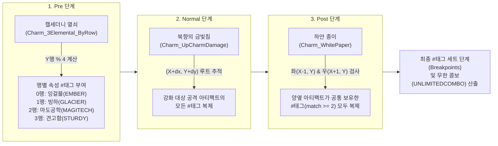
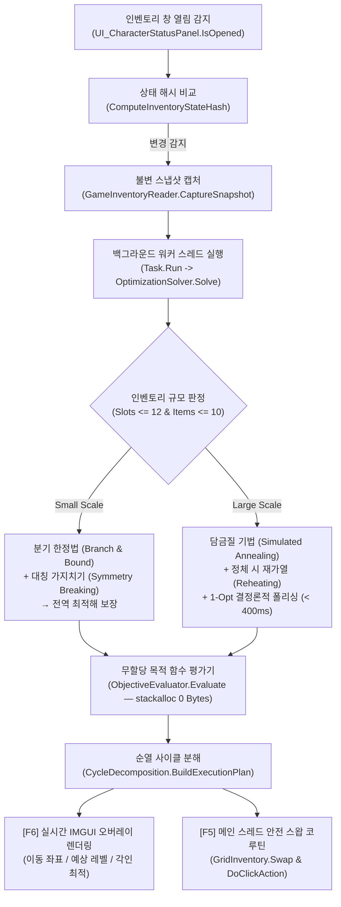

# SephiriaOptimizer (세피리아 인벤토리·석판·콤보 자동 최적화 모드)


-success)


스팀 게임 **세피리아(Sephiria)** 인벤토리의 아티팩트(`Charm_Basic`), 석판(`StoneTablet`), 동적 세트 콤보(`#태그`), 그리고 재능(`Passive`/`StatusInstance`) 규칙을 실시간 분석하여 **1) 단축키 한 번으로 최적 슬롯 자동 재배치(`[F5]`)**, **2) 슬롯 위 시각적 오버레이 가이드(`[F6]`)**, **3) 빌드 맞춤 아티팩트 우선순위·목표 콤보·금빛침 타겟 설정(`[F7]`)**을 제공하는 하이브리드 인게임 모드입니다.

> **별도의 모드 로더(`BepInEx` 등) 설치가 전혀 필요 없습니다!**
> 세피리아 게임 엔진에 내장된 공식 `AddOnLoader`(`HorayModBase`) 시스템을 그대로 사용하므로, 파일만 넣거나 원클릭 설치기를 실행하면 즉시 동작합니다.

---

## 목차 (Table of Contents)
1. [🚀 일반 유저용 3초 원클릭 자동 설치 & 제거 가이드](#-일반-유저용-3초-원클릭-자동-설치--제거-가이드)
2. [🎮 인게임 단축키 및 UI 완벽 가이드](#-인게임-단축키-및-ui-완벽-가이드)
3. [🧠 세피리아 도메인 최적화 규칙 상세 명세](#-세피리아-도메인-최적화-규칙-상세-명세)
   - [3.1 유효 레벨 클램핑 및 비활성화 방어](#31-유효-레벨-클램핑-및-비활성화-방어)
   - [3.2 10종 아티팩트 위치·이웃 제약 조건 & IgnoreCriteria 시너지](#32-10종-아티팩트-위치이웃-제약-조건--ignorecriteria-시너지)
   - [3.3 캘세더니 열쇠 & 하얀 종이 동적 #태그 콤보 파이프라인 (Pre → Normal → Post)](#33-캘세더니-열쇠--하얀-종이-동적-태그-콤보-파이프라인-pre--normal--post)
   - [3.4 북향의 금빛침 (Charm_UpCharmDamage) 타겟 지정·연쇄·2배 증폭 최적화](#34-북향의-금빛침-charm_upcharmdamage-타겟-지정연쇄2배-증폭-최적화)
   - [3.5 아티팩트 5단계 강화 우선순위 (ArtifactPriorityTier)](#35-아티팩트-5단계-강화-우선순위-artifactprioritytier)
   - [3.6 재능(Talent) 및 특수 빌드 규칙 자동 대응 (생존 20 석판 각인 등)](#36-재능talent-및-특수-빌드-규칙-자동-대응-생존-20-석판-각인-등)
   - [3.7 위치·이웃 의존 특수 아티팩트 시너지](#37-위치이웃-의존-특수-아티팩트-시너지)
4. [⚡ 알고리즘 및 아키텍처 설계](#-알고리즘-및-아키텍처-설계)
5. [❓ 자주 묻는 질문 (FAQ & 문제 해결)](#-자주-묻는-질문-faq--문제-해결)
6. [🛠️ 개발자용 프로젝트 구조 및 빌드·테스트 가이드](#️-개발자용-프로젝트-구조-및-빌드테스트-가이드)

---

## 🚀 일반 유저용 3초 원클릭 자동 설치 & 제거 가이드

코드를 직접 빌드하거나 스팀 폴더(`steamapps\common\Sephiria`)가 어느 드라이브에 있는지 직접 찾을 필요가 없습니다.
자동 설치기가 **스팀 레지스트리(`libraryfolders.vdf`)와 PC 내 모든 드라이브(`C:`, `D:`, `E:` 등)를 자동으로 스캔**하여 세피리아 설치 폴더를 찾아내고, 윈도우 외부 DLL 보안 차단 해제(`Unblock-File`)까지 자동으로 마친 뒤 설치를 완료합니다.

### 방법 1. ZIP 패키지 다운로드 후 더블클릭 (가장 추천 ⭐)
1. **[👉 SephiriaOptimizer_v2.0.0.zip 바로 다운로드](https://raw.githubusercontent.com/lij0825/SephiriaOptimizer/main/Dist/SephiriaOptimizer_v2.0.0.zip)** 링크를 클릭해 다운로드한 뒤 압축을 풉니다.
2. 압축을 푼 폴더 안의 **`설치하기_Install.bat`** 파일을 **더블클릭**합니다.
3. `"세피리아 최적화 모드(SephiriaOptimizer) 설치가 완료되었습니다!"` 알림창이 뜨면 끝입니다!
   - **최신 버전 업데이트**: 동봉된 **`온라인_최신버전_자동설치.bat`**을 더블클릭하면 언제든 GitHub의 최신 버전 `.dll`을 자동으로 받아 업데이트합니다.
   - **모드 삭제**: 동봉된 **`제거하기_Uninstall.bat`**을 더블클릭하면 1초 만에 깔끔하게 제거됩니다.

### 방법 2. 파일 다운로드조차 필요 없는 PowerShell 한 줄 설치
압축 파일을 받고 푸는 과정조차 생략하고 싶다면, 윈도우 시작 메뉴에서 **PowerShell**을 열고 아래 명령어 한 줄을 복사해 붙여넣은 뒤 엔터(`Enter`)를 누르세요:

```powershell
irm https://raw.githubusercontent.com/lij0825/SephiriaOptimizer/main/Dist/install.ps1 | iex
```
> 실행 즉시 GitHub에서 최신 `SephiriaOptimizer.dll`과 `metadata.json`을 다운로드하여 세피리아 폴더에 자동 설치하고 완료 알림창을 띄웁니다.

### 방법 3. 수동 설치 (직접 폴더에 넣기)
직접 파일을 복사하고 싶다면 [`Dist/`](./Dist) 폴더의 `SephiriaOptimizer.dll`과 `metadata.json` 두 파일을 세피리아 설치 경로 아래 `AddOns\SephiriaOptimizer\` 폴더에 넣어주세요:
```text
{세피리아 설치 폴더 (예: D:\Steam\steamapps\common\Sephiria)}\
└── AddOns\
    └── SephiriaOptimizer\
        ├── SephiriaOptimizer.dll
        └── metadata.json
```
> ⚠️ **수동 설치 시 주의사항**: 브라우저에서 직접 받은 `.dll` 파일은 윈도우 보안 정책상 차단(Mark of the Web)될 수 있습니다. 수동으로 넣을 경우 `SephiriaOptimizer.dll` **우클릭 → 속성 → 하단 [차단 해제] 체크 → 확인**을 눌러주세요. (위 **방법 1** 또는 **방법 2**를 쓰면 이 과정이 자동으로 처리됩니다.)

---

## 🎮 인게임 단축키 및 UI 완벽 가이드

게임을 실행하고 세이브 파일을 불러온 뒤 **인벤토리 창(`I` 또는 `Tab`)**을 열면 인벤토리 상단에 **Sephiria Optimizer** 컨트롤 패널과 슬롯 오버레이가 자동으로 표시됩니다. (인벤토리 창을 닫으면 모든 UI가 자동으로 숨겨집니다.)

### 1. 단축키 및 마우스 조작 일람

| 입력 키 / 조작 | 동작 기능 | 상세 설명 |
| :---: | :--- | :--- |
| **`[F5]`** (또는 상단 버튼) | **자동 최적 재배치 실행** | 솔버가 찾은 최적 배치로 아이템 스왑(`Swap`) 및 석판 회전(`DoClickAction`)을 프레임 단위로 안전하게 자동 수행합니다. 전투 중이거나 이동 잠금 상태일 때는 자동으로 오버레이 가이드 모드로 전환됩니다. |
| **`[F6]`** (또는 상단 버튼) | **시각적 가이드 오버레이 켜기/끄기** | 각 인벤토리 슬롯 위에 표시되는 이동 목표 좌표, 회전 각도, 예상 레벨 배지를 토글합니다. |
| **`[F7]`** (또는 상단 버튼) | **빌드 맞춤 설정 창 열기/닫기** | **목표 `#태그` 콤보 선택**, **북향의 금빛침 강화 대상 지정**, **아티팩트별 5단계 강화 우선순위**를 설정하는 전용 창을 엽니다. |
| **슬롯 우클릭** *(Pin 모드 OFF)* | **아티팩트 강화 우선순위 빠른 순환** | 아티팩트 위에 마우스를 올리고 우클릭할 때마다 `●보통 → ★최우선 → ▲높음 → ▼토템 → ✕희생` 순으로 우선순위가 즉시 변경되며 최적 배치가 재계산됩니다. |
| **슬롯 우클릭** *(Pin 모드 ON)* | **특정 슬롯 위치 고정(Pin) / 해제** | 상단 패널에서 `[Pin: ON]`을 켠 뒤 슬롯을 우클릭하면 해당 슬롯의 아이템(또는 빈칸) 위치와 회전이 고정(`PIN`)되어 이동 대상에서 제외됩니다. |
| **슬롯 마우스 오버 / 좌클릭** | **이동 경로 하이라이트 연결선** | 특정 슬롯에 마우스를 올리거나 좌클릭하면 현재 슬롯(하늘색 테두리)에서 이동해야 할 목표 슬롯(초록색 테두리)까지 직관적인 연결선을 그려줍니다. |

---

### 2. 슬롯 오버레이 배지 읽는 법

인벤토리 각 슬롯 위에는 최적 배치 적용 시의 결과를 미리 보여주는 배지가 표시됩니다:

| 배지 위치 | 표시 예시 | 색상 | 의미 |
| :---: | :---: | :---: | :--- |
| **슬롯 상단** | `→[2, 3]` | 남색 (하늘색 글씨) | 현재 슬롯에 있는 아이템이 최적 배치에서 **`2열 3행`(`[X=2, Y=3]`) 슬롯으로 이동**해야 함을 뜻합니다. |
| **슬롯 상단** | `↻ +90°` / `+180°` / `+270°` | 보라색 | 제자리에 머무는 회전 가능 석판을 **시계 방향으로 몇 도 회전(우클릭)**해야 하는지 표시합니다. |
| **슬롯 우상단** | `★최우선` / `▲높음` / `▼토템` / `✕희생` | 금색 / 청록 / 회색 / 자주색 | 해당 아티팩트에 지정된 **강화 우선순위 등급**입니다(`●보통`은 화면이 복잡해지지 않도록 생략). |
| **슬롯 좌상단** | `PIN` + 노란 테두리 | 노란색 | 사용자가 위치를 고정한 슬롯입니다. |
| **슬롯 하단** | `Lv.3 (MAX)` | 초록색 | 최적 배치 적용 시 해당 아티팩트가 **최대 별 개수(`MaxLevel`)까지 풀강화**됨을 의미합니다. |
| **슬롯 하단** | `Lv.2/4` | 파란색 | 최적 배치 적용 시 아티팩트가 활성화되며 유효 레벨이 `2`가 됨을 의미합니다. |
| **슬롯 하단** | `-1 (비활성 경고)` / `제약 미충족` / `비활성 (X)` | 빨간색 | 레벨이 `-1` 이하가 되었거나, 위치 제약 조건 미충족, 또는 석판 `"X"` 효과로 인해 **아티팩트가 비활성화됨**을 경고합니다. |
| **슬롯 하단** | `희생(콤보유지)` | 자주색 | 사용자가 **`✕희생` 등급으로 지정한 토템 아티팩트**가 석판의 `-N` 또는 `"X"` 페널티를 대신 흡수하여 주력 아티팩트를 보호하고 있음을 나타냅니다(정적 `#태그` 콤보 개수는 그대로 유지됨). |
| **슬롯 하단** | `각인 최적` | 황토색/금색 | **생존 20(석판 각인)** 재능 보유 시, 석판의 발동 조건은 켜진 상태이면서 `-N`/`"X"` 페널티는 인벤토리 바깥으로 빠져 있어 **지금 각인하면 페널티 없이 이득만 영구 각인할 수 있는 최적 위치**임을 알려줍니다. |

---

### 3. `[F7]` 빌드 맞춤 설정 패널 상세 가이드

`[F7]` 키를 누르면 인벤토리 좌측에 **빌드 맞춤 최적화 설정 창**이 열립니다:

1. **목표 콤보(`#태그`) 선택 (캘세더니 열쇠 & 하얀 종이 타겟팅)**
   - 기본값인 `[자동 (활성 콤보 기반)]` 상태에서는 현재 인벤토리에 보유한 아티팩트들의 `#태그` 개수를 분석해 다음 세트 단계(`Breakpoints`, 예: `2 / 4 / 6 / 8`세트) 달성에 가장 가까운 태그를 자동으로 노립니다.
   - `#잉걸불`, `#빙하`, `#마도공학`, `#견고함`, `#바람노래`, `#역병`, `#그림자`, `#비전`, `#수호`, `#정밀`, `#번개`, `#호수`, `#동료`, `#행성`, `#만취`, `#저주` 버튼을 클릭해 `★잉걸불`처럼 직접 지정하면, 솔버가 **캘세더니 열쇠**와 **하얀 종이**를 해당 태그가 복제되는 행과 위치에 최우선 배치합니다.
2. **북향의 금빛침 강화 대상 선택**
   - 인벤토리에 보유한 공격 판정 아티팩트(`IAttackableCharm`) 목록이 버튼으로 나열됩니다(고급 이하 등급이어서 금빛침 2배 증폭 조건을 받는 아티팩트는 `(고급이하★2배)` 표시가 자동으로 붙습니다).
   - 원하는 공격 아티팩트를 클릭해 선택하면, 모든 `북향의 금빛침`이 해당 아티팩트 아래(오프셋 역방향)로 모이도록 강제 배치합니다.
3. **아티팩트별 5단계 강화 우선순위 설정**
   - 현재 인벤토리에 있는 모든 아티팩트의 이름, 기본/최대 레벨, 현재 우선순위를 확인하고 `[★최우선]`, `[▲높음]`, `[●보통]`, `[▼토템]`, `[✕희생]` 버튼으로 즉시 변경할 수 있습니다.

---

## 🧠 세피리아 도메인 최적화 규칙 상세 명세

`SephiriaOptimizer`는 추측성 휴리스틱이 아니라, 세피리아의 `Assembly-CSharp.dll`을 역공학하여 추출한 **실제 인게임 수식과 판정 순서**를 1:1로 구현했습니다.

### 3.1 유효 레벨 클램핑 및 비활성화 방어

인게임 `GridInventory.ReleasePermission()`의 레벨 계산 공식을 그대로 따릅니다:
1. **기본 슬롯 레벨 및 배율 합산**:
   - 던전 임시 레벨(`dungeonTempLevels`), 영구 각인 레벨(`fixedEngravingsOnServer`, `engravings`), 그리고 활성화된 석판(`StoneTablet.IsApplied == true`)의 `+N` / `-N` 효과(`IncreaseConstLevel`)를 모두 합산한 뒤, 배율 석판(`MultiplyConstLevel`, `×N`) 효과를 곱해 슬롯 보너스 레벨 $\Delta L_s$를 구합니다.
2. **표시 레벨(`DisplayedLevel`) 및 유효 레벨(`EffectiveLevel`) 클램핑**:
   $$\text{DisplayedLevel}_i = \text{BaseLevel}_i + \Delta L_s$$
   $$L_i = \min\left(\text{MaxLevel}_i,\ \max(0, \text{DisplayedLevel}_i)\right)$$
   - 별 개수(`MaxLevel`)를 초과하는 잉여 레벨 버프는 점수 `0`으로 처리하여, 이미 만렙인 아티팩트에 석판 버프가 낭비되지 않고 다른 아티팩트로 분산되도록 유도합니다.
3. **비활성화 판정 및 페널티 증발**:
   - 인게임 규칙상 $\text{DisplayedLevel}_i \le -1$이 되거나 석판의 비활성화(`"X"`, `EffectType.Disable`) 효과를 받으면 아티팩트 효과가 완전히 무효화(`SetEffectEnable(false)`)됩니다.
   - 솔버는 석판의 `-N` 또는 `"X"` 타겟 좌표가 **1) 인벤토리 그리드 바깥(또는 미해금 슬롯)**, **2) 빈 슬롯**, **3) 레벨 개념이 없는 다른 석판**, 또는 **4) 사용자가 `✕희생`으로 지정한 토템 아티팩트**를 향하도록 위치와 회전을 최적화하여 페널티를 완벽히 증발시킵니다.

---

### 3.2 10종 아티팩트 위치·이웃 제약 조건 & `IgnoreCriteria` 시너지

세피리아에 존재하는 10종의 `CharmActivateCriteria` 서브클래스를 모두 정확히 판정합니다:

| 제약 조건 타입 (`ArtifactConstraintType`) | 인게임 클래스명 | 활성화 판정 조건 (`CurrentInventoryStorage` 기준) |
| :--- | :--- | :--- |
| **`TopInInventory`** | `CharmActivateCriteria_TopInInventory` | 최상단 행(`Y == 0`) 슬롯에 배치될 때만 활성화 |
| **`BottomInInventory`** | `CharmActivateCriteria_BottomInInventory` | 현재 해금된 슬롯(`UnlockedSlots`) 기준 **해당 열(`X`)에서 가장 아래쪽 해금 행**일 때만 활성화 (`PosToIdx(X, Y + 1) >= UnlockedSlots`) |
| **`SideEnd`** | `CharmActivateCriteria_SideEnd` | 좌측 끝 열(`X == 0`) 또는 우측 끝 열(`X == Width - 1`)에 배치될 때만 활성화 |
| **`Outlined`** | `CharmActivateCriteria_Outlined` | 최상단(`Y == 0`), 좌우 끝(`X == 0` 또는 `Width - 1`), 또는 해당 열의 최하단 해금 슬롯(`PosToIdx(X, Y + 1) >= UnlockedSlots`) 중 하나에 해당할 때 활성화 |
| **`Inside`** | `CharmActivateCriteria_Inside` | 위 `Outlined`(외곽)에 해당하지 않는 **내부 슬롯**에 배치될 때만 활성화 |
| **`BothSideCharm`** | `CharmActivateCriteria_BothSideCharm` | 좌측(`[X - 1, Y]`)과 우측(`[X + 1, Y]`) 해금 슬롯 **모두에 아티팩트(`Charm`)가 배치**되어 있을 때만 활성화 |
| **`BothSidesAreEmpty`** | `CharmActivateCriteria_BothSidesAreEmpty` | 좌측(`[X - 1, Y]`)과 우측(`[X + 1, Y]`)이 **그리드 밖이거나 빈 슬롯**일 때만 활성화 |
| **`Near8MagicBook`** | `CharmActivateCriteria_Near8MagicBook` | 주변 8방향(`[-1..+1, -1..+1]`) 인접 슬롯 중 **마법서(`Charm_Magic`)가 1개 이상 존재**할 때만 활성화 |
| **`NeighborsAreFull`** | `CharmActivateCriteria_NeighborsAreFull` | 상하좌우 4방향 중 인벤토리 내부의 유효 슬롯이 **모두 아이템으로 채워져 있을 때** 활성화 |
| **`FullHp`** | `CharmActivateCriteria_FullHP` | 플레이어의 현재 체력이 최대 체력(`hp == MaxHp`)일 때 활성화 |

- **제약 조건 무시(`IgnoreCriteria`) 시너지**:
  - 석판의 `IGNORECRITERIA` 효과가 들어온 슬롯에 위 제약 조건이 달린 아티팩트를 배치하면, 위치/체력 조건을 만족하지 않아도 강제로 활성화되며 높은 시너지 보너스 점수를 부여합니다.

---

### 3.3 캘세더니 열쇠 & 하얀 종이 동적 `#태그` 콤보 파이프라인 (`Pre → Normal → Post`)

세피리아의 `GridInventory.ReleasePermission()`(2664~2671행)은 아티팩트의 동적 카테고리를 반드시 **`ECharmCalculationOrder.Pre` $\rightarrow$ `Normal` $\rightarrow$ `Post`** 순서로 실행한 뒤 `SearchSetEffectInInventory()`를 호출합니다. 본 모드의 평가기는 이 파이프라인을 비트마스크 연산으로 완벽히 재현합니다:



- **캘세더니 열쇠 (`Charm_3Elemental_ByRow`)**:
  - 배치된 행 인덱스(`Y % 4`)에 따라 결정되는 속성 태그가 사용자의 목표 콤보(`TargetComboCategories`) 또는 다음 세트 브레이크포인트 달성에 기여하도록 최적의 행에 배치합니다.
  - 동시에 해당 행에 대응하는 플레이어의 속성 공격력(화염/냉기/번개/물리) 및 아티팩트 레벨별 속성 스탯 보너스(`addElementalStatByLevel`)까지 목적 함수에 반영합니다.
- **하얀 종이 (`Charm_WhitePaper`)**:
  - 하얀 종이는 자체 레벨(`maxLevel == 0`)이 없지만, 좌우(`[X - 1, Y]`, `[X + 1, Y]`)에 놓인 두 아이템이 공통으로 가진 `#태그`(`match >= 2`)를 모두 자기 자신에게 복제합니다.
  - 특히 `Pre`/`Normal` 단계에서 **캘세더니 열쇠**나 **북향의 금빛침**이 동적으로 획득한 태그도 하얀 종이가 `Post` 단계에서 그대로 복제할 수 있으므로, `캘세더니 열쇠 — 하얀 종이 — 목표 태그 아티팩트`를 같은 행에 나란히 세워 한 번에 `+3` 콤보를 터뜨리는 고난도 배치까지 자동으로 찾아냅니다!

---

### 3.4 북향의 금빛침 (`Charm_UpCharmDamage`) 타겟 지정·연쇄·2배 증폭 최적화

역공학으로 확인한 `Charm_UpCharmDamage.cs` 및 `Charm_Basic.RequestCharmDamageBonusOnRoot()`의 모든 세부 규칙을 반영했습니다:
1. **방향 오프셋 타겟팅 (`xOffset`, `yOffset`)**:
   - 북향의 금빛침(`[0, -1]`) 등 방향성 강화 아티팩트가 가리키는 슬롯에 반드시 **공격 판정 아티팩트(`IAttackableCharm.IsAttackableCharm() == true`)**가 오도록 배치합니다. 비공격형 아티팩트나 빈 슬롯을 가리키면 경고 페널티를 부여합니다.
2. **고급(`Uncommon`) 이하 등급 2배 증폭 (`hasDependencyCondition`)**:
   - 인게임 `Charm_UpCharmDamage.GetDamageBonus()`는 강화 대상 루트 아티팩트의 등급이 `maxRarity`(기본 `EItemRarity.Uncommon`, 고급) 이하일 때 기본 `damageBonusByLevel`에 더해 `dependencyDamageBonusByLevel`을 추가로 합산(피해량 보너스 2배)합니다.
   - 솔버는 이 조건부 추가 피해량(`GetNeedleBonusPercent`)과 루트 아티팩트의 중요도·유효 레벨을 곱해 가장 폭발적인 딜 상승이 나오는 타겟 아래에 금빛침을 배치합니다.
3. **다중 금빛침 연쇄 (`침 B → 침 A → 공격 아티팩트`)**:
   - 금빛침을 2개 이상 보유했을 때 `침 B`가 `침 A`를 가리키고 `침 A`가 `공격 아티팩트`를 가리키면, `RequestCharmDamageBonusOnRoot` 재귀 호출을 통해 두 침의 피해 증폭과 카테고리 복제가 모두 루트 공격 아티팩트에 중첩 적용됩니다.
4. **사용자 지정 타겟 (`PreferredNeedleTargetInstanceId`)**:
   - `[F7]` 설정 창에서 특정 공격 아티팩트를 직접 지목하면, 솔버가 최우선으로 해당 아티팩트에 금빛침 체인을 연결합니다.

---

### 3.5 아티팩트 5단계 강화 우선순위 (`ArtifactPriorityTier`)

어떤 아티팩트에 석판의 `+레벨`을 몰아주고 어떤 아티팩트를 버릴지 사용자가 완벽히 통제할 수 있습니다:

| 등급 | UI 표기 | 가중치 배율 | 비활성화 페널티 | 핵심 용도 및 최적화 동작 |
| :---: | :---: | :---: | :---: | :--- |
| **`Core`** | `★최우선` | **$\times 3.0$** (+보너스) | **강함 ($\times 2.0$)** | 빌드 핵심 메인 딜러 아티팩트. 석판의 `+레벨` 버프와 금빛침을 최우선으로 배정받습니다. |
| **`High`** | `▲높음` | **$\times 1.8$** | **높음 ($\times 1.4$)** | 서브 딜러 및 핵심 유틸리티 아티팩트. 전설(`Legend`) 이상 아티팩트의 기본 등급입니다. |
| **`Normal`** | `●보통` | **$\times 1.0$** | **기본 ($\times 1.0$)** | 일반 아티팩트의 기본 등급입니다. |
| **`Low`** | `▼토템` | **$\times 0.33$** | **낮음 ($\times 0.5$)** | 레벨 상승 효율이 낮거나 `maxLevel == 0`인 아티팩트. 남는 안전 슬롯에 배치됩니다. |
| **`Sacrifice`** | `✕희생` | **$0$** | **$0$ (완전 면제 + 흡수 보너스)** | **순수 `#태그` 콤보 카운트용 토템 아티팩트** 또는 무기 불일치/듀얼 비활성 아티팩트. 석판의 `-N`이나 `"X"` 타겟 칸에 자진 배치되어 주력 아티팩트 대신 디버프를 흡수합니다. |

---

### 3.6 재능(`Talent`) 및 특수 빌드 규칙 자동 대응 (`생존 20` 석판 각인 등)

플레이어의 재능(`PassiveDatabase` / `StatusInstance`) 및 하드모드 제약을 실시간으로 읽어와 최적화 규칙을 동적으로 변경합니다:

1. **재능: 생존 20 (`StatusInstance_TabletEngraving` / `inventory.tabletEngravingCount > 0`)**:
   - **인벤토리 `-12칸` 축소 대응**: 줄어든 `CurrentInventoryStorage`를 실시간으로 감지하여 `BottomInInventory`, `Outlined`, `Inside` 제약 조건의 경계선을 축소된 인벤토리 크기에 맞춰 정확히 재계산합니다.
   - **영구 각인 효과(`FixedEngraving`) 합산**: 이미 각인하여 인벤토리 바닥에 새겨진 `+레벨`, `×배율`, `제약 조건 무시`, `비활성화` 효과를 기본 슬롯 스탯에 반영합니다.
   - **석판 각인용 페널티 영구 증발 유도 (`각인 최적`)**: 인게임 `FixedEngraving.ApplyEffect()`는 석판을 각인할 때 **`PosToIdx >= CurrentInventoryStorage`(해금된 인벤토리 바깥)를 향하는 효과를 아예 기록하지 않고 영구 소멸**시킵니다. 따라서 생존 20이 활성화된 상태에서는 석판의 발동 조건(`conditionQuery`)은 켜면서 `-N`/`"X"` 페널티는 인벤토리 경계 밖을 향하도록 유도하며, 이 조건을 달성한 석판 위에 **`각인 최적`** 배지를 띄워 유저가 바로 각인할 수 있도록 안내합니다!
2. **고유한 한 쌍 (`StatusInstance_UniquePair` / `inventory.uniquePairCount > 0`)**:
   - 인벤토리 내 아티팩트·석판의 종류 구성을 감지하여 고유 효과 연계를 보존합니다.
3. **무한 콤보 (`UNLIMITEDCOMBO` 커스텀 스탯)**:
   - 특정 `#태그`의 최대 브레이크포인트를 초과한 잉여 콤보 카운트(`excessCount`)가 다른 활성 콤보들의 카운트를 `+excessCount`만큼 밀어 올려주는 `GridInventory.ApplyUnlimitedCombo()` 로직을 그대로 시뮬레이션합니다.
4. **콤보 당 최종 피해 (`COMBOBONUSDAMAGE`) & 배치 보너스 (`ARRANGEMENTBONUS`)**:
   - 활성화된 콤보 단계 수에 비례하는 최종 피해 증폭 가중치와, `ItemDatabase.GetAllArrangementBonuses()`에 등록된 특정 아이템 상대 좌표 배치 패턴 달성 보너스를 계산합니다.
5. **듀얼 아티팩트 비활성화 (`DISABLEDUALARTIFACT`) & 중복 아티팩트 콤보 제한 (`OVERLAPITEMCOMBO`)**:
   - 해당 재능/하드모드 제약이 켜져 있을 때 비활성화되는 듀얼 아티팩트를 자동으로 `✕희생` 토템으로 전환하고, 동일 ID 아티팩트의 중복 콤보 카운트를 제외합니다.

---

### 3.7 위치·이웃 의존 특수 아티팩트 시너지

단순 레벨뿐만 아니라 주변 아티팩트 배치에 따라 위력이 달라지는 특수 아티팩트들의 위치 시너지까지 모두 계산합니다:

- **`Charm_NearLevelDamage` (인접 레벨 비수 등)**: 주변 8방향(`[-1..+1, -1..+1]`)에 배치된 아티팩트들의 총 레벨 합(`nearTotalLevel`)이 가장 높은 중심부 슬롯에 배치합니다.
- **`Charm_CompanionChaos` (혼돈의 동료 등)**: 같은 행(`Y`)에 동료 아티팩트(`ICompanionCharm`)들이 많이 모이도록 같은 줄에 정렬합니다.
- **`Charm_PlanetModule` (행성 모듈)**: 주변 8방향에 행성 아티팩트(`PLANET` 카테고리 / `Charm_SummonGreenBat`)가 인접하도록 밀집 배치합니다.
- **`Charm_NearMagicBullet` (마법 탄환 등)**: 같은 열(`X`)에 마법서(`Charm_Magic`)들이 위치하도록 열 정렬을 유도합니다.
- **`Charm_WoodenBox` (목각 상자)**: 인벤토리 최상단 6칸(`0 ~ 5번 슬롯`)에 아티팩트가 가득 차도록 유도합니다.
- **`Charm_FireIce` / `Charm_FireIceWeapon` (화염과 냉기)**: 플레이어의 화염 공격력(`FireDamage`)과 냉기 공격력(`IceDamage`) 중 더 높은 쪽에 맞춰 인벤토리 좌측 절반(화염) 또는 우측 절반(냉기)에 배치합니다.
- **마법서 우측 인접 보조 아티팩트 (`Charm_AutoMagic`, `Charm_ReduceMPCost`, `Charm_RightSpellCooldownHelper`)**: 자신의 바로 오른쪽 슬롯(`[X + 1, Y]`)에 마법서(`Charm_Magic`)가 오도록 짝지어 배치합니다.

---

## ⚡ 알고리즘 및 아키텍처 설계



1. **프레임 드랍 `0%` 비동기 스냅샷 아키텍처**:
   - Unity 메인 스레드에서는 인벤토리 상태가 바뀔 때만 가벼운 불변 스냅샷(`InventorySnapshot`)을 복제하고, 무거운 탐색 연산은 전부 `Task.Run` 백그라운드 스레드에서 수행합니다.
2. **단일 평가당 `0 Bytes` 힙 할당 (`stackalloc`)**:
   - 수만 번 호출되는 `ObjectiveEvaluator.Evaluate()` 내부에서 `new` 키워드를 통한 배열/객체 생성을 철저히 배제하고, `stackalloc int[64]` 및 `stackalloc uint[64]` 스택 버퍼만 사용하여 가비지 컬렉션(GC) 스파이크가 전혀 발생하지 않습니다.
3. **순열 사이클 분해 (`CycleDecomposition`) 기반 최소 스왑 보장**:
   - 현재 슬롯 배열과 최적 슬롯 배열 사이의 치환(Permutation)을 서로소 사이클(Disjoint Cycles)로 분해하여 수학적 최소 횟수($N - C$)의 `GridInventory.Swap(x1, y1, x2, y2)` 호출만으로 재배치를 완료합니다.
   - 인게임 정규 메서드를 프레임 단위로 호출하므로 아이템 증발 위험이 전혀 없으며, 스탯·콤보 재계산과 멀티플레이어 Mirror 네트워크 동기화가 100% 정상 작동합니다.

---

## ❓ 자주 묻는 질문 (FAQ & 문제 해결)

<details>
<summary><b>Q1. 게임을 켰는데 아무 화면도 안 떠요!</b></summary>

- 모드 UI는 게임 플레이 화면을 가리지 않도록 **인벤토리 창(`I` 또는 `Tab`)을 열었을 때만** 인벤토리 위쪽에 나타납니다.
- 만약 인벤토리를 열어도 상단 바가 보이지 않는다면:
  1. [`Dist/설치하기_Install.bat`](./Dist/설치하기_Install.bat)을 실행해 올바른 세피리아 폴더(`AddOns\SephiriaOptimizer\`)에 설치되었는지 확인하세요.
  2. 수동으로 `.dll`을 넣으셨다면 파일 우클릭 → 속성 → **[차단 해제]**를 체크했는지 확인하세요.
</details>

<details>
<summary><b>Q2. [F5] 자동 정렬을 눌렀는데 아이템이 안 움직여요!</b></summary>

- 전투 중(`IsInBattle`)이거나 인벤토리 이동이 잠긴 상태에서는 게임 규칙상 아이템 스왑이 불가능하므로, 안전을 위해 자동으로 **오버레이 가이드 모드(`[F6]`)**로 전환됩니다. 전투가 끝난 뒤 비전투 상태에서 `[F5]`를 누르시면 자동으로 정렬됩니다.
- 또한 현재 배치가 이미 수학적 최고 점수에 도달한 상태라면 `"이미 최적 배치 상태입니다"` 메시지가 표시되며 불필요한 스왑을 하지 않습니다.
</details>

<details>
<summary><b>Q3. 특정 아티팩트(예: 무기 전용 아티팩트나 내가 원하는 자리의 아티팩트)는 안 움직이게 고정하고 싶어요!</b></summary>

- 상단 패널의 **`[Pin: OFF]`** 버튼을 눌러 **`[Pin: ON]`**으로 바꾼 뒤, 고정하고 싶은 인벤토리 슬롯 위에서 **마우스 우클릭**을 하면 노란색 `PIN` 테두리가 생기며 해당 슬롯은 절대 이동하거나 회전하지 않습니다.
</details>

<details>
<summary><b>Q4. 콤보 숫자만 채우는 저등급 아티팩트가 석판 +레벨을 뺏어가는 걸 막으려면 어떻게 하나요?</b></summary>

- `Pin 모드`가 꺼진 상태에서 해당 저등급 아티팩트 슬롯을 **우클릭**하여 **`✕희생`**(또는 `▼토템`) 등급으로 바꿔주세요!
- `✕희생`으로 지정하면 솔버가 그 아티팩트에는 `+레벨`을 주지 않을 뿐 아니라, 오히려 석판의 `-레벨`이나 `"X"` 비활성화 칸에 그 아티팩트를 대신 집어넣어 주력 아티팩트를 보호합니다(세피리아 규칙상 비활성화되어도 `#태그` 콤보 개수는 그대로 유지됩니다).
</details>

---

## 🛠️ 개발자용 프로젝트 구조 및 빌드·테스트 가이드

### 디렉터리 구조

```text
SephiriaOptimizer/
├── Dist/                                     # 일반 유저용 원클릭 자동 설치기 및 빌드 배포본
│   ├── SephiriaOptimizer_v2.0.0.zip          # 원클릭 설치 패키지 (DLL + 설치/제거/온라인업데이트 bat)
│   ├── 설치하기_Install.bat                  # 스팀 경로 자동 탐지 + 차단 해제 + 자동 설치 스크립트
│   ├── 제거하기_Uninstall.bat                # 원클릭 모드 제거 스크립트
│   ├── 온라인_최신버전_자동설치.bat          # GitHub 최신 DLL 다운로드 및 설치 런처
│   ├── install.ps1                           # PowerShell 원라이너(irm | iex) 설치 스크립트
│   ├── SephiriaOptimizer.dll                 # 최신 릴리즈 빌드 바이너리
│   └── metadata.json                         # 세피리아 내장 AddOnLoader 메타데이터
├── SephiriaOptimizer/                        # 메인 모드 C# 프로젝트 (.NET Standard 2.1)
│   ├── Execution/
│   │   └── CycleDecomposition.cs             # 순열 사이클 분해 및 회전 시퀀스 생성기
│   ├── Models/
│   │   ├── ArtifactConstraintType.cs         # 10종 제약 조건, 5단계 우선순위, 석판 효과 열거형
│   │   ├── InventorySnapshot.cs              # 워커 스레드용 불변 인벤토리 스냅샷
│   │   ├── SlotCoord.cs                      # 그리드 좌표 구조체
│   │   ├── SlotItemSnapshot.cs               # 아티팩트/석판/동적 시너지 스냅샷 및 대칭 그룹 ID
│   │   ├── TabletPlacementRule.cs            # 슬롯·회전별 사전 계산된 석판 규칙
│   │   └── TalentAndComboModels.cs           # 콤보 브레이크포인트, 재능(생존 20 등), 유저 설정 모델
│   ├── Snapshot/
│   │   └── GameInventoryReader.cs            # 인게임 GridInventory & PlayerAvatar 데이터 리더
│   ├── Solver/
│   │   ├── ObjectiveEvaluator.cs             # stackalloc 기반 무할당 목적 함수 평가기 (Pre->Normal->Post)
│   │   ├── OptimizationResult.cs             # 최적화 결과 및 슬롯별 상세 평가 데이터
│   │   └── OptimizationSolver.cs             # Branch & Bound + Simulated Annealing 하이브리드 솔버
│   ├── UI/
│   │   └── SephiriaOptimizerController.cs    # [F5] 자동 스왑 코루틴, [F6] 오버레이, [F7] 빌드 설정 UI
│   ├── SephiriaOptimizerMod.cs               # HorayModBase 엔트리포인트
│   ├── metadata.json                         # AddOnLoader 메타데이터 원본
│   └── SephiriaOptimizer.csproj              # 프로젝트 설정 파일
└── SephiriaOptimizer.Tests/                  # xUnit 단위 테스트 프로젝트 (.NET 8.0)
    ├── OptimizationSolverTest.cs             # 9개 핵심 도메인 시나리오 검증 테스트
    └── SephiriaOptimizer.Tests.csproj        # 테스트 프로젝트 설정 파일
```

### 소스 코드 빌드 및 단위 테스트 실행

```powershell
# 1. 전체 솔루션 Release 빌드 (경고 0, 오류 0 검증)
dotnet build SephiriaOptimizer.sln -c Release --no-incremental

# 2. 도메인 단위 테스트 9종 실행
dotnet test SephiriaOptimizer.sln -c Release --no-build
```

### 포함된 자동화 단위 테스트 목록 (`OptimizationSolverTest.cs`)
1. `Evaluate_ClampsEffectiveLevelAndPenalizesNegativeLevel`: 아티팩트 유효 레벨의 최대 별 개수(`MaxLevel`) 클램핑 및 최종 레벨 `-1` 이하 비활성화 페널티 부과 검증
2. `Solve_NeutralizesNegativeLevelPenaltyByPointingOutsideOrEmpty`: 석판의 `-N` 레벨 감소 효과를 그리드 바깥이나 빈 슬롯으로 유도해 페널티를 증발시키는 최적화 검증
3. `Solve_PlacesConstrainedArtifactOnIgnoreCriteriaSlot`: 제약 조건(`Inside` 등)이 달린 아티팩트를 석판의 `IgnoreCriteria` 타겟 슬롯에 배치해 강제 활성화하는 시너지 검증
4. `Solve_PlacesChalcedonyKeyAndWhitePaperToCompleteTargetCombo`: **캘세더니 열쇠**와 **하얀 종이**를 목표 콤보(`#태그`) 행 및 동일 태그 아티팩트 사이에 배치해 세트 단계를 달성하는지 검증
5. `Solve_PlacesGoldenNeedleBelowTargetAttackableArtifactAndCopiesCategories`: **북향의 금빛침**을 지정된 고급(`Uncommon`) 공격 아티팩트 아래에 배치해 등급 조건부 2배 피해 증폭과 카테고리 복제를 달성하는지 검증
6. `Solve_PrioritizesCoreArtifactsAndUsesSacrificeArtifactsToAbsorbNegativeTabletEffects`: `★최우선(Core)` 아티팩트에 버프를 집중하고 `✕희생(Sacrifice)` 토템 아티팩트로 석판의 `-N` 페널티를 흡수하는지 검증
7. `Solve_AppliesSurvival20TabletEngravingAndPermanentSlotBonuses`: **생존 20(`TabletEngravingCount > 0`)** 재능 활성화 시 줄어든 인벤토리 경계 밖으로 석판 페널티를 유도(`IsEngravingReady`)하고 영구 각인 슬롯 보너스를 반영하는지 검증
8. `Solve_LargeScaleSimulatedAnnealingImprovesScoreWithinBudget`: 24슬롯 대규모 인벤토리에서 담금질 기법(SA) + 재가열(Reheating)이 `400ms` 이내에 최적 배치를 도출하는지 검증
9. `BuildExecutionPlan_DecomposesPermutationIntoMinimalSwaps`: 순열 사이클 분해가 최소 횟수의 2-슬롯 교환으로 현재 배치를 최적 배치로 정확히 변환하는지 검증
