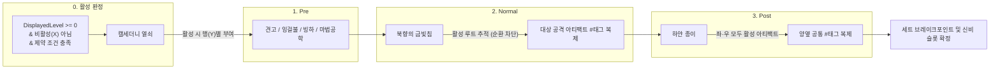
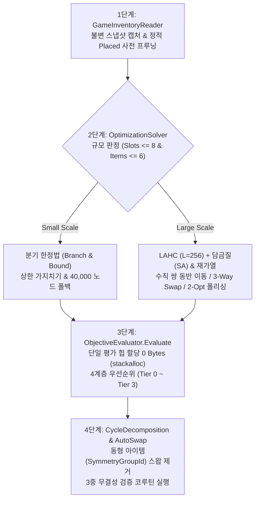

# SephiriaOptimizer


-success)


**세피리아(Sephiria)** 인벤토리의 아티팩트, 석판, 세트 콤보(`#태그`), 재능 규칙을 분석하여 **자동 최적 재배치(`[F5]`)**, **슬롯 오버레이 가이드(`[F6]`)**, **빌드 맞춤 설정(`[F7]`)**을 제공하는 인게임 모드입니다.

> 별도의 모드 로더(`BepInEx` 등) 없이 세피리아 내장 공식 `AddOnLoader`로 동작합니다.

---

## 목차
1. [설치 및 제거](#1-설치-및-제거)
2. [인게임 조작 및 UI](#2-인게임-조작-및-ui)
3. [도메인 최적화 규칙](#3-도메인-최적화-규칙)
4. [최적화 파이프라인 및 아키텍처](#4-최적화-파이프라인-및-아키텍처)
5. [문제 해결 (FAQ & Troubleshooting)](#5-문제-해결-faq--troubleshooting)
6. [개발 및 빌드](#6-개발-및-빌드)

---

## 1. 설치 및 제거

### 1.1 설치 및 업데이트
1. [**SephiriaOptimizer_v2.0.0.zip 다운로드**](https://raw.githubusercontent.com/lij0825/SephiriaOptimizer/main/Dist/SephiriaOptimizer_v2.0.0.zip) 후 압축을 해제합니다 (`우클릭 → 모두 압축 풀기`).
2. 압축을 푼 폴더에서 운영체제에 맞는 설치 스크립트를 실행합니다 (업데이트 시에도 동일):
   - **Windows**: `Install.bat` 더블클릭
   - **Linux / SteamOS (Steam Deck) / macOS**:
     ```bash
     chmod +x ./install.sh && ./install.sh
     ```
3. 설치 완료 알림 확인 후 게임을 실행하고 인벤토리(`I` 또는 `Tab`)를 열면 상단 컨트롤 바가 표시됩니다.

### 1.2 제거
- **Windows**: `Uninstall.bat` 더블클릭
- **Linux / SteamOS / macOS**:
  ```bash
  ./install.sh --uninstall
  ```

### 1.3 지원 환경 및 자동 처리 항목
- **다중 스팀 라이브러리 탐색**: 기본 경로 외 타 드라이브(`D:\SteamLibrary` 등), `libraryfolders.vdf`, Steam Deck MicroSD(`/run/media/mmcblk0p1`), Linux Flatpak/Snap, macOS `Sephiria.app` 경로를 자동 탐색합니다.
- **비표준 경로 1회 기억**: 자동 탐색이 불가능한 포터블 경로는 폴더 선택 창이 열리며, 1회 선택한 경로는 저장되어 이후 업데이트·제거 시 재입력이 필요 없습니다 (`--game-dir "<경로>"`로 변경 가능).
- **한글·특수문자 경로 지원**: 계정명이나 폴더명에 한글, 공백, `(1)`, `[ ]`, `&`, `!`가 포함된 환경에서도 정상 동작합니다.
- **권한·잠금·보안 차단 처리**: `Program Files (x86)` 관리자 권한(UAC) 승격 요청, Windows DLL 보안 차단(`Zone.Identifier`) 및 macOS 격리 속성(`com.apple.quarantine`) 해제, 게임 실행 중 파일 잠금 감지, 구버전 클라이언트(`AddOnLoader` 미포함) 감지를 자동 수행합니다.

---

## 2. 인게임 조작 및 UI

인벤토리 창(`I` 또는 `Tab`)을 열면 상단에 컨트롤 패널과 슬롯 오버레이가 표시되며, 인벤토리를 닫으면 숨겨집니다.

### 2.1 단축키 및 마우스 조작

| 입력 / 조작 | 기능 | 설명 |
| :---: | :--- | :--- |
| **`[F5]`** (또는 상단 버튼) | **자동 최적 재배치** | 최적 배치로 아이템 위치 교환 및 석판 회전을 자동 실행합니다. 전투 중이거나 이동 잠금 상태일 때는 오버레이 가이드 모드로 전환됩니다. |
| **`[F6]`** (또는 상단 버튼) | **가이드 오버레이 토글** | 슬롯 위 이동 목표 좌표, 회전 각도, 예상 레벨 배지를 켜거나 끕니다. |
| **`[F7]`** (또는 상단 버튼) | **빌드 맞춤 설정 창** | 캘세더니 열쇠 속성, 목표 세트 콤보, 북향의 금빛침 대상, 아티팩트별 강화 우선순위를 설정합니다. |
| **`[속도: 즉시/순차]` 버튼** | **실행 속도 전환** | `즉시`: 1프레임 일괄 실행 / `순차`: 프레임당 1스텝씩 실행 |
| **슬롯 우클릭** *(Pin OFF)* | **우선순위 빠른 순환** | 아티팩트 우선순위를 `보통 → 최상 → 높음 → 낮음 → 최하` 순으로 변경하고 재계산합니다. |
| **슬롯 우클릭** *(Pin ON)* | **슬롯 위치 고정(Pin)** | 해당 슬롯(아이템 또는 빈칸)의 위치와 회전을 고정하여 이동 대상에서 제외합니다. |
| **슬롯 마우스 오버 / 좌클릭** | **이동 경로 표시** | 현재 슬롯(하늘색)에서 목표 슬롯(초록색)까지의 이동 연결선을 표시합니다. |

### 2.2 슬롯 오버레이 배지

| 위치 | 표시 예시 | 색상 | 의미 |
| :---: | :---: | :---: | :--- |
| **상단** | `→[2, 3]` | 남색 | 최적 배치에서 `2열 3행`(`X=2, Y=3`) 슬롯으로 이동 |
| **상단** | `↻ +90°` / `+180°` / `+270°` | 보라색 | 현재 슬롯에서 시계 방향 회전(우클릭) 각도 |
| **우상단** | `최상` / `높음` / `낮음` / `최하` | 금색 / 청록 / 회색 / 자주색 | 지정된 강화 우선순위 등급 (`보통`은 생략) |
| **좌상단** | `PIN` | 노란색 | 위치·회전이 고정된 슬롯 |
| **하단** | `Lv.3 (MAX)` | 초록색 | 최대 레벨(`MaxLevel`) 달성 |
| **하단** | `Lv.2/4` | 파란색 | 활성 상태 및 예상 유효 레벨 |
| **하단** | `-1 (비활성 경고)` / `제약 미충족` / `비활성 (X)` | 빨간색 | 레벨 `-1` 이하, 위치 제약 미충족, 또는 석판 `"X"`로 인한 비활성화 경고 |
| **하단** | `최하(콤보유지)` | 자주색 | `최하` 등급 아티팩트가 `-N`/`"X"` 디버프를 대신 흡수 중 (정적 `#태그` 카운트는 유지) |
| **하단** | `각인 최적` | 금색 | **생존 20(석판 각인)** 보유 시 페널티가 그리드 밖으로 빠져 각인 효율이 가장 높은 석판 |

### 2.3 `[F7]` 빌드 설정 창
1. **캘세더니 열쇠 목표 속성 (`견고 / 잉걸불 / 빙하 / 마법공학`)**: 행(`Y % 4`)에 따라 부여되는 4종 속성 중 선택한 속성의 행에 배치합니다.
2. **하얀 종이 & 세트 목표 콤보 (20종)**: `잉걸불`, `얼음무구`, `빙하`, `마법공학`, `그림자`, `수호`, `바람노래`, `신비`, `행성`, `동료`, `정밀`, `먹구름`, `견고`, `호수`, `태양검`, `아카데미`, `저주`, `교섭`, `원소`, `연금술` 중 선택한 태그를 공유하는 두 활성 아티팩트 사이에 하얀 종이를 우선 배치합니다.
3. **북향의 금빛침 강화 대상**: 보유 중인 공격 아티팩트 목록에서 대상을 지정하면 금빛침을 해당 아티팩트 바로 아래 슬롯에 배치합니다 (`고급` 이하 등급은 `2배` 증폭 표시).
4. **아티팩트 5단계 강화 우선순위 (`최상 / 높음 / 보통 / 낮음 / 최하`)**: 인벤토리 내 각 아티팩트의 강화 우선순위를 개별 지정합니다.

---

## 3. 도메인 최적화 규칙

### 3.1 유효 레벨·배율·신비 증폭 및 버프 낭비 방지
- **슬롯 레벨 및 배율(`×M`) 계산**: 영구 각인·임시 레벨과 활성 석판의 `+N`/`-N` 레벨 효과를 합산하고 배율 석판(`MultiplyConstLevel`)을 적용합니다. 변화량이 `0`인 슬롯의 배율 낭비와 음수 디버프 증폭(`-2 → -4`)을 구분해 평가합니다.
- **신비(`MYSTIC`) 2/4세트 증폭**: 동적 태그 확정 후 활성화된 신비 슬롯에 대해 석판 및 각인 레벨 수치를 `×2`로 증폭합니다.
- **최대 레벨 클램핑**:
  $$\text{DisplayedLevel}_i = \left(\text{BaseLevel}_i + \Delta L_s\right) \times \max(1, M_s), \quad L_i = \min\left(\text{MaxLevel}_i,\ \max(0, \text{DisplayedLevel}_i)\right)$$
  `MaxLevel`을 초과한 잉여 버프에는 감점을 부여하여 다른 아티팩트로 버프를 분산합니다.
- **버프 손실 및 중첩 차단**: 석판의 `+` 효과·`제약 무시`·`×배율`이 인벤토리 밖으로 이탈하거나 빈 슬롯(`+`/`-` 상쇄 포함)에 버려지는 배치, 다른 석판이 강화한 `+` 슬롯 위에 석판을 올리는 배치를 페널티로 차단합니다.

### 3.2 아티팩트·석판 위치 제약 조건
비직사각형 해금 인벤토리(`UnlockedSlots % Width != 0`)에서도 유효 높이 `effectiveHeight = (UnlockedSlots + Width - 1) / Width` 기준으로 석판의 `Placed(TOP / BOTTOM / LEFTEND / RIGHTEND / BORDER / INNER / CORNER)` 조건과 아래 10종 아티팩트 제약을 판정합니다.

| 제약 타입 | 인게임 클래스 | 활성화 조건 (`UnlockedSlots` 기준) |
| :--- | :--- | :--- |
| **`TopInInventory`** | `CharmActivateCriteria_TopInInventory` | 최상단 행(`Y == 0`) |
| **`BottomInInventory`** | `CharmActivateCriteria_BottomInInventory` | 하단 `Width`개 해금 슬롯(`slotIndex >= UnlockedSlots - Width`) |
| **`SideEnd`** | `CharmActivateCriteria_SideEnd` | 좌측 끝(`X == 0`) 또는 우측 끝(`X == Width - 1`) 열 |
| **`Outlined`** | `CharmActivateCriteria_Outlined` | 상단·하단·좌우 외곽 해금 슬롯 |
| **`Inside`** | `CharmActivateCriteria_Inside` | 상하좌우가 모두 해금 슬롯으로 둘러싸인 내부 슬롯 |
| **`BothSideCharm`** | `CharmActivateCriteria_BothSideCharm` | 좌우(`[X-1, Y]`, `[X+1, Y]`) 해금 슬롯에 모두 아티팩트 배치 |
| **`BothSidesAreEmpty`** | `CharmActivateCriteria_BothSidesAreEmpty` | 좌우 슬롯이 모두 비어 있고 우하단 경계 조건 충족 |
| **`Near8MagicBook`** | `CharmActivateCriteria_Near8MagicBook` | 인접 8방향 중 마법서(`Charm_Magic`) 1개 이상 존재 |
| **`NeighborsAreFull`** | `CharmActivateCriteria_NeighborsAreFull` | 인접 8방향 슬롯이 모두 해금되어 있고 아이템으로 채워짐 |
| **`FullHp`** | `CharmActivateCriteria_FullHP` | 현재 체력이 최대 체력 이상(`hp >= MaxHp`) |

### 3.3 동적 `#태그` 콤보 파이프라인 (`Pre → Normal → Post`)



- 동적 태그 아티팩트 본체나 참조 대상 아티팩트가 비활성화된 경우 태그 부여·복제 및 시너지 점수가 차단됩니다.

### 3.4 북향의 금빛침 (`Charm_UpCharmDamage`)
- 주력 공격 아티팩트(`IAttackableCharm`) 바로 아래 슬롯(`rootSlot + Width`) 결합을 최우선으로 배치하며, 신비 슬롯을 불필요하게 점유하지 않습니다.
- 대상 루트 아티팩트가 `고급(Uncommon)` 이하 등급이면 피해 증폭률을 `2배`로 계산합니다.
- 다중 금빛침 연쇄(`침 B → 침 A → 공격 아티팩트`)를 지원하며, 상호 순환 참조(`A <-> B`)는 64비트 비트마스크로 즉시 차단합니다.

### 3.5 아티팩트 5단계 강화 우선순위

| 등급 | UI 표기 | 가중치 배율 | 동작 요약 |
| :---: | :---: | :---: | :--- |
| **`Core`** | **`최상`** | $\times 3.0$ | 주력 딜러 아티팩트. 석판 `+레벨` 버프와 금빛침을 최우선 배정 |
| **`High`** | **`높음`** | $\times 1.8$ | 서브 딜러 및 주요 아티팩트 |
| **`Normal`** | **`보통`** | $\times 1.0$ | 기본 등급 |
| **`Low`** | **`낮음`** | $\times 0.33$ | 레벨 효율이 낮은 보조 아티팩트. 남는 안전 슬롯에 배치 |
| **`Sacrifice`** | **`최하`** | $0$ | `#태그` 카운트용 토템. `+레벨`을 피하고 순수 `-N`/`"X"` 디버프 슬롯을 대신 흡수 |

### 3.6 재능 및 특수 아티팩트 시너지
- **재능 — 생존 20 (석판 각인)**: `-12칸` 축소 인벤토리 경계 재계산, 바닥 영구 각인 효과(`FixedEngraving`) 합산, 석판 페널티 외부 배출(`각인 최적`)을 반영합니다.
- **재능 — 고유한 한 쌍 / 무한 콤보 / 콤보 당 최종 피해 / 배치 보너스**: 활성 재능 수치를 목적 함수에 자동 반영합니다.
- **조화의 수정 (`Crystal of Harmony`) & `Charm_NearLevelDamage`**: 인접 8칸(3×3 Moore Neighborhood) 활성 아티팩트들의 유효 레벨 총합을 극대화하며, 주변 아티팩트 레벨을 높여주는 석판의 인접 진입을 허용합니다.
- **기타 위치 시너지**: `혼돈의 동료`(동일 행 동료 밀집), `행성 모듈`(인접 8칸 행성 밀집), `마법 탄환`(동일 열 마법서 정렬), `목각 상자`(상단 0~5번 슬롯 충전), `화염과 냉기`(공격력 우세 속성 기준 좌·우 반쪽 배치), 마법서 우측 보조 아티팩트(`[X+1, Y]` 마법서 인접)를 모두 반영합니다.

---

## 4. 최적화 파이프라인 및 아키텍처



- **무할당 평가기 (`0 Bytes` GC Alloc)**: [`ObjectiveEvaluator.Evaluate()`](./SephiriaOptimizer/Solver/ObjectiveEvaluator.cs) 및 탐색 루프는 `stackalloc`, `Span<T>`, `ulong` 비트마스크만 사용하여 힙 할당 없이 동작합니다.
- **4계층 절대 우선순위 (`Tier 0 ~ Tier 3`)**: 아티팩트 비활성화 방지 및 석판 `+` 칸 침범 금지(`Tier 0`) → 핵심 결합·세트 브레이크포인트(`Tier 1`) → 우선순위별 유효 레벨 및 조화의 수정 증폭(`Tier 2`) → 잉여 버프 정리 및 타이브레이커(`Tier 3`) 순으로 계층 간 점수 역전을 방지합니다.
- **최소 스왑 실행 및 무결성 검증**: [`CycleDecomposition.BuildExecutionPlan()`](./SephiriaOptimizer/Execution/CycleDecomposition.cs)으로 동형 아이템·빈 슬롯 간 불필요한 이동을 제거하고, [`SephiriaOptimizerController`](./SephiriaOptimizer/UI/SephiriaOptimizerController.cs)가 매 스텝 인벤토리 상태·커서 파지 여부·`InstanceID` 일치 여부를 검증합니다.

---

## 5. 문제 해결 (FAQ & Troubleshooting)

<details>
<summary><b>Q1. Install.bat 실행 시 SephiriaOptimizer.dll을 찾을 수 없다고 표시됩니다. (종료 코드 2)</b></summary>

- `.zip` 파일을 압축 해제하지 않고 탐색기 미리보기(`%TEMP%`) 안에서 바로 실행한 경우입니다.
- `SephiriaOptimizer_v2.0.0.zip`을 **우클릭 → [모두 압축 풀기]**로 일반 폴더에 푼 뒤 `Install.bat`(또는 `install.sh`)을 실행하세요.
</details>

<details>
<summary><b>Q2. 게임이 실행 중이거나 파일이 잠겨 있다는 경고가 표시됩니다. (종료 코드 3)</b></summary>

- 게임 실행 중에는 `SephiriaOptimizer.dll`이 잠겨 교체할 수 없습니다. 게임을 종료한 뒤 알림창의 **`[다시 시도]`**(콘솔은 `R` 입력)를 누르세요.
</details>

<details>
<summary><b>Q3. Program Files (x86) 경로에서 쓰기 권한 오류가 발생합니다. (종료 코드 4)</b></summary>

- 자동 표시되는 **관리자 권한(UAC) 창**에서 **`[예]`**를 눌러 승인하거나, `Install.bat`을 **우클릭 → [관리자 권한으로 실행]**(Linux/macOS는 `sudo ./install.sh`)하세요.
</details>

<details>
<summary><b>Q4. 공식 내장 AddOnLoader가 없다는 오류가 표시됩니다. (종료 코드 5)</b></summary>

- 세피리아 클라이언트가 구버전이거나 손상된 상태입니다. **Steam → 세피리아 속성 → 설치된 파일 → [게임 파일 무결성 검사]** 및 최신 업데이트 후 다시 실행하세요.
</details>

<details>
<summary><b>Q5. 저장된 게임 경로를 다른 폴더로 변경하고 싶습니다. (종료 코드 1)</b></summary>

- 아래 명령으로 새 경로를 지정해 실행하면 저장된 캐시(`game_path.txt`)가 즉시 갱신됩니다:
  ```powershell
  Install.bat --game-dir "E:\MyGames\Sephiria"
  ```
</details>

<details>
<summary><b>Q6. UI가 보이지 않거나 [F5]를 눌러도 아이템이 이동하지 않습니다.</b></summary>

- 모드 UI는 **인벤토리 창(`I` 또는 `Tab`)이 열려 있을 때만** 표시됩니다.
- 전투 중, 인벤토리 이동 잠금 상태, 마우스 커서로 아이템을 집고 있는 상태에서는 안전을 위해 오버레이 가이드 모드(`[F6]`)로만 동작하며, 이미 최고 점수 배치인 경우 추가 스왑을 수행하지 않습니다.
</details>

---

## 6. 개발 및 빌드

### 디렉터리 구조

```text
SephiriaOptimizer/
├── Dist/                                     # 배포 패키지 및 크로스 플랫폼 설치 스크립트
│   ├── SephiriaOptimizer_v2.0.0.zip          # Release 빌드 시 자동 생성되는 배포 패키지
│   ├── Install.bat / Uninstall.bat           # Windows 설치·제거 런처
│   ├── install.ps1                           # 자동 경로 탐색·검증·설치 코어 스크립트
│   ├── install.sh                            # Linux / SteamOS / macOS 설치·제거 스크립트
│   └── SephiriaOptimizer.dll / metadata.json # 빌드 바이너리 및 애드온 메타데이터
├── SephiriaOptimizer/                        # 메인 모드 프로젝트 (.NET Standard 2.1)
│   ├── Execution/CycleDecomposition.cs       # 동형 매칭 및 순열 사이클 분해
│   ├── Models/                               # 불변 스냅샷, 제약 조건, 콤보·재능 모델
│   ├── Snapshot/GameInventoryReader.cs       # 인게임 인벤토리 리더 및 석판 쿼리 파서
│   ├── Solver/ObjectiveEvaluator.cs          # stackalloc 무할당 4계층 목적 함수 평가기
│   ├── Solver/OptimizationSolver.cs          # B&B + LAHC/SA 최적화 솔버
│   ├── UI/SephiriaOptimizerController.cs     # 인게임 단축키·오버레이·설정 창 컨트롤러
│   └── SephiriaOptimizerMod.cs               # HorayModBase 엔트리포인트
└── SephiriaOptimizer.Tests/                  # xUnit 단위 테스트 프로젝트 (.NET 8.0+, 21종)
```

### 빌드 및 테스트 명령어

`SephiriaOptimizer.csproj`는 환경 변수(`SEPHIRIA_GAME_DIR`), 저장된 경로 캐시(`.sephiria-path`, `game_path.txt`), 레지스트리, 다중 드라이브 및 `libraryfolders.vdf`를 순차 탐색하여 `Sephiria_Data/Managed` 참조를 자동 연결합니다.

```powershell
# Release 빌드 및 Dist/SephiriaOptimizer_v2.0.0.zip 패키지 갱신
dotnet build SephiriaOptimizer.sln -c Release --no-incremental

# 빌드 후 로컬 게임 폴더(AddOns/SephiriaOptimizer)에 즉시 배포
dotnet build SephiriaOptimizer.sln -c Release -p:DeployToGame=true

# 게임 경로 수동 지정 빌드
dotnet build SephiriaOptimizer.sln -c Release -p:SephiriaDir="E:\CustomGames\Sephiria"

# 단위 테스트 실행 (21 tests)
dotnet test SephiriaOptimizer.sln -c Release --no-build
```
